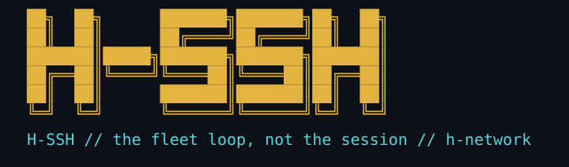

<div align="center">


 
<br/>

[](LICENSE)


</div>

# h-ssh

`h-ssh` runs commands across a fleet of network devices: one device or three hundred, Juniper, any SSH host, or a console
still speaking telnet. Devices are worked in parallel, results are collected per device, and one dead box does not sink a run:
every run probes the boxes first (unless you say `--no-probe`), without logging in, so a dead one is a FAIL within seconds,
and an edit does not go on without a box the probe found dead unless you say so.

The per-device session is a solved problem; what is left is everything around it: the thread pool, per-device result collection, a rate
limiter (`--safety-file`) so a router that already failed is not hammered, and a record of what changed (`--audit-log`). That is
the part h-ssh provides.

On Junos, everything goes through PyEZ over NETCONF, reads and writes alike, which gives one session, real RPC errors, and the lock, diff
and rollback that config changes need. Every edit is probed for reachability (unless `--no-probe`) and prompts before it commits;
with `--audit-log` it lands in a JSONL audit trail.
`--commit-confirmed` puts the device back the way it was if you never confirm.

## Features

- **Four transports, one interface.** Juniper (PyEZ over NETCONF), any SSH host through paramiko or the system `ssh` binary, and raw-socket telnet with IOS-, Junos-, Arista- and NX-OS-flavoured prompt handling. Same flags whichever you point it at; the ones only a Junos transport can honour (`--dry-run` on an edit, `--show-diff`, `--commit-confirmed`, and over NETCONF `--comment`, `--format`, `--rollback`, `--commit-status`) are refused on the others device by device: such a device is a FAIL with the reason, nothing is sent to it, and the run exits 1; never faked.
- **Parallel by default.** Devices are worked concurrently behind an `asyncio` semaphore, `--workers 8` out of the box.
- **One command or many, one device or many.** `--batch` runs several commands per device on a single connection; `--job` takes a JSON file with different commands — and different modes — per device, readable from a file or stdin.
- **A dead box costs seconds, not a worker.** Every run starts with a probe (`--no-probe` skips it) — a TCP connect and the SSH banner, no login, 100 boxes at a time — and goes to the boxes that answered; `--probe` alone is a health check of the fleet, with each box's TCP handshake round trip as the kernel measured it and the time its sshd took to answer. See [The probe](#the-probe).
- **Writes are gated.** The probe's question before a partial deployment, `y/N` confirmation, `--dry-run` that shows the diff without committing and `--commit-confirmed N` for changes that undo themselves unless you confirm within N minutes (both Junos), and an opt-in per-device rate limit and cooldown (`--safety-file`).
- **Templates instead of memorised syntax.** `-sC bgp` resolves through a per-vendor JSON template library — *per target*, so the same shortcut sends a Junos router and an EOS switch each their own command. Drop your own in `~/.h-ssh/commands/{dialect}.json` (`junos`, `ios`, `nxos`, `eos`, `none`) to add or override; `junos`, `eos` and `none` ship one.
- **Built to be scripted.** `--json` on stdout, a structured summary line on stderr, meaningful exit codes, and credentials from `HSSH_USER` / `HSSH_PASSWORD` — or import `hssh` and skip the CLI entirely. A whole fleet run fits in one YAML file (`--run fleet.yaml`) that a pipeline step or a jump-host session runs as it is.
- **Built for a maintenance, not just a run.** A session pool keeps one NETCONF session per router open for a whole script; `rpc()` and `--format json|xml` return the router's own data instead of CLI text; `begin()` holds a diffed candidate open until a gate decides; `--rollback N`, commit comments, `--commit-status` and `guarded_commit()` cover the commit-confirmed lifecycle without a `| match` in sight.
- **Two runtime dependencies — or none.** `paramiko` and `junos-eznc` come with the package. Telnet is a raw socket (no stdlib `telnetlib`, so it still works on Python 3.13+), and the `openssh` transport drives the system `ssh` binary, so a checkout on a locked-down jump host with nothing installable still runs shows and edits over `ssh`.

## How it works

```
  hosts / devices.csv / --job                 per device, up to --workers at once
  ──────────────────────────────────           ─────────────────────────────────────
                    │
                    ▼
        ┌───────────────────────┐
        │ probe, no login       │──▶ a dead box: FAIL in seconds
        │ TCP + SSH banner      │    (an edit asks before it goes
        │ 100 boxes at once     │     on without one)
        └───────────────────────┘
                    │ the boxes that answered
                    │                          ┌─ junos    PyEZ over NETCONF (830)
                    ▼                          │           show/edit → PyEZ NETCONF
        ┌───────────────────────┐              │                  lock → load → diff
        │ safety gate (opt-in)  │              │                  → commit → unlock
        │ rate limit 10/device  │──▶ workers ──┼─ ssh      exec_command
        │ cooldown 120s on fail │              │
        │ --safety-file, flock'd│              ├─ openssh  the ssh binary, no deps
        └───────────────────────┘              └─ telnet   raw TCP + prompt match
                    │                                          │
                    └──────────── every edit ──────────────────┴──▶ --audit-log (JSONL)
```

On Junos, show commands run through PyEZ `Device.cli()` over one NETCONF session (a batch shares it); a reply whose text opens with the CLI's refusal (`error: could not resolve file: ...` as the `<output>`, where most refusals come back as an RPC error) is a failure, `'CMD' was refused by the device: ...`, as on the text transports, and is not tried again; a transaction's `tx.show()` raises it too. The NETCONF port defaults to 830 for every Junos call; set the target's port to use NETCONF on 22. Config changes lock the candidate, load, diff, run `commit_check`, commit, and unlock, rolling back if any step fails. Confirming a commit-confirmed (`-eC "commit"`) first reads the commit history: with no commit-confirmed waiting (the timer expired, or it was confirmed already) the device fails with *nothing to confirm* and nothing is sent, because a plain commit there would hide that the change is already gone. It locks too, so another user's uncommitted edits in the shared candidate refuse it — nothing sent, retried like any other lock refusal — instead of riding along with the confirmation. The "don't forget to confirm" reminder prints only when at least one device actually armed a timer. A commit whose reply never arrives is reported as *outcome unknown* and is never retried or rolled back automatically — check the device (and any commit-confirmed timer) first. The NETCONF session verifies the router's host key by default since #150 (a default change: before it, the password went to whoever answered on the port, a router whose key had changed included), on the store the `ssh` transport keeps: `HSSH_NETCONF_HOSTKEY=accept-new` (the default) pins an unknown router in `~/.h-ssh/known_hosts` on first contact, under `[HOST]:PORT`, and refuses one whose key is not the one pinned there or in `~/.ssh/known_hosts` before the password goes (`host key verification failed for HOST:PORT: its key is not the one pinned in FILE (or ~/.ssh/known_hosts); if the router was re-keyed, remove its line`; a router the two files disagree on is refused too); `yes` refuses an unknown router as well (`not pinned in ~/.h-ssh/known_hosts or ~/.ssh/known_hosts`); `no` is the opt-out to the old behaviour, for a re-keyed router that must not stop a maintenance; anything else is refused, and the variable is read per call. `~/.ssh/known_hosts` is read as the `ssh` transport reads it: its `@cert-authority` lines are passed over, and a key it marks `@revoked` is refused (`host key verification failed for HOST:PORT: its key is marked @revoked in FILE`). With a password, no `~/.ssh/id_*` key and no agent is tried first. A session that does not open is reported by what happened, not by PyEZ's label (which calls anything that fails within 3 s *refused*): `connection refused by HOST:PORT` or `no route to host HOST:PORT` (what the OS answered the TCP connect, where ncclient says only "Could not open socket"), `TCP connect to HOST:PORT timed out after Ns`, `HOST:PORT is not an SSH server: the banner is not text`, `HOST:PORT dropped the session before login after Ns (sshd connection limit?)`, `no SSH banner from HOST:PORT within Ns`, `no SSH session to HOST:PORT within Ns: the banner came, but key exchange did not finish`, `host key verification failed`, `authentication failed for USER at HOST:PORT`, `cannot resolve HOST`, and `local open-file limit reached (ulimit -n N): this machine had no descriptor for a session to HOST:PORT; nothing was sent` when this process is out of descriptors, for the socket (which ncclient swallows, so it read *connection refused* for a port that was listening) or for what the session opens after it; the system's file table full (ENFILE) says `fs.file-max, not ulimit -n` instead. That one is this machine's limit, not the device's answer: a `hssh.errors.OpenFileLimitError` (a `NotAppliedError` and a `LocalError`), not tried again, and no `--safety-file` cooldown for the device. A `delete` of a statement the device does not have is a no-op (`warning: statement not found` is the one load warning that is ignored, so a broadcast of deletes stays idempotent); every other warning still fails the device. `--session-timeout` is one deadline for the whole session set-up — TCP connect, SSH banner, key exchange, authentication — not PyEZ's connect timeout followed by paramiko's own 15 s banner, 15 s key-exchange and 30 s authentication timeouts, and the router's NETCONF hello after it has `--session-timeout` of its own. Within that deadline `--connect-timeout` (3 s) bounds the TCP connect and the banner together, so a router that does not answer, or accepts TCP and then says nothing, costs 3 s an attempt and is tried again (see [Failure handling](#failure-handling)); a slow key exchange, login or hello still has the session timeout. An IPv6 literal cannot be used on this transport at all (PyEZ refuses the bare form, ncclient cannot resolve the bracketed one); it is reported once, as such.

## Install

One line, no package manager. It needs `python3` 3.10 or newer with its venv module (Debian/Ubuntu:
`sudo apt install python3-venv`) and `git`:

```bash
curl -fsSL https://raw.githubusercontent.com/h-network/h-ssh/develop/install.sh | sh
h-ssh --list-vendors
```

The installer puts h-ssh in a Python environment of its own, `~/.h-ssh/venv`, with every transport
(paramiko and PyEZ come with it), and links `h-ssh` and `h-ssh-store` into `~/.local/bin`, creating
that directory when it is missing; if it is not on your `PATH` yet the script says so and how to add
it. Your config, inventory, shortcuts and profiles live next to the environment under `~/.h-ssh` (the
result store is `./h-ssh.db` in the directory you run from, unless you name another), and pip's
download cache lands in its usual place (`~/.cache/pip` on Linux). Running the same line again
upgrades, whatever the version number says. It installs the `develop` branch; a knob on the `sh` side
of the pipe picks another branch or tag: `curl -fsSL … | H_SSH_REF=main sh` for the release branch.
`H_SSH_REPO`, `H_SSH_HOME`, `H_SSH_BIN` and `H_SSH_PYTHON` are the others, see the script's header.
Removing it:

```bash
curl -fsSL https://raw.githubusercontent.com/h-network/h-ssh/develop/install.sh | sh -s -- --uninstall
```

takes the environment and the two links away and leaves `~/.h-ssh` otherwise alone; it never touches
an `h-ssh` in `~/.local/bin` that it did not put there (a pipx or uv install, your own wrapper), and
neither does an install. Read the script first if you like: a page of POSIX sh that does what this
paragraph says.

If you already use [pipx](https://pipx.pypa.io) or [uv](https://docs.astral.sh/uv/), the same thing in
their words: `pipx install git+https://github.com/h-network/h-ssh.git` or
`uv tool install git+https://github.com/h-network/h-ssh.git` (the default branch, `develop`; add `@main`
for the release branch).

For working on h-ssh itself:

```bash
git clone -b develop https://github.com/h-network/h-ssh.git && cd h-ssh
python3 -m venv .venv && . .venv/bin/activate
pip install -e '.[dev]'           # the package, editable, plus pytest, pytest-cov and ruff
```

The checkout's `./h-app/h-ssh.py` is the same CLI without installing, on an interpreter that has
`paramiko` and `junos-eznc`; the `openssh` and `telnet` transports need neither. The store reader has
no script there: `PYTHONPATH=h-app python3 -c 'from hssh.store import main_sync; main_sync()' runs` is
`h-ssh-store runs`.

## Quick start

```bash
# a show on two routers typed bare: the host is the name, --transport the driver; you are the user
# you are logged in as, the password is asked for (keys and agents need nothing)
h-ssh --transport junos 10.0.1.1 10.0.1.2 -sC bgp

# the same, named, the vendor on the target, as another user
h-ssh --user admin -sC bgp R1:10.0.1.1:junos R2:10.0.1.2:junos

# ... or from a CSV inventory, as JSON (the sample inventory in a checkout has junos, openssh and ssh rows)
h-ssh --user admin --json -sC "show version" --devices h-app/devices.csv

# compare one command's output across the fleet: each device against the first that answered, in
# target order (bare hosts, then --target; or the inventory's rows)
h-ssh -sC bgp --diff R1:10.0.1.1:junos R2:10.0.1.2:junos

# config change — look before you leap (no host typed: the inventory is ~/.h-ssh/devices.csv, or
# ./devices.csv; these are Junos lines: an ssh or openssh row fails --dry-run and --commit-confirmed,
# and gets the set line as a command)
h-ssh --user admin -eC "set system ntp server 10.0.0.1" --dry-run
h-ssh --user admin -eC "set system ntp server 10.0.0.1" -y

# a change that rolls itself back in 10 minutes unless you confirm
h-ssh --user admin -eB configs/all.set --commit-confirmed 10 -y

# several commands per device, one connection
h-ssh --batch commands.txt R1:10.0.1.1:junos
h-ssh --profile junos-health R1:10.0.1.1:junos     # a named command set, yours or shipped (--list-profiles)

# watch: the same read again 30 s after each tick, every tick kept in the store, only what changed is printed
h-ssh -sC "show bgp summary" --every 30 R1:10.0.1.1:junos R2:10.0.1.2:junos

# a console server still speaking telnet
h-ssh -sC "show version" SW1:10.0.0.1:5000:telnet-ios

# is every box there? one line each, no login (the same probe runs before every run)
h-ssh --probe

# every run is kept in ./h-ssh.db (a --probe too), as the devices answered; read it back
h-ssh-store runs
h-ssh-store output R1 20261027-0930    # R1's reply in that run: an id from the list, or a unique prefix
```

Targets are typed bare on the command line, before or between the flags (not right after a `--commit-confirmed` that has no N: the target would be read as the minutes). A host alone (`10.0.1.1`, `cr1.example.net`, `[2001:db8::1]`) is a device named after itself on `--transport`; `NAME:HOST`, `NAME:HOST:VENDOR`, `NAME:HOST:PORT` or `NAME:HOST:PORT:VENDOR` name it (`NAME:HOST:VENDOR:PORT` works too; the confirm hint writes a job's targets that way), an IPv6 host in brackets, `R1:[2001:db8::1]:junos`. A port needs a name: `10.0.1.1:830` is read as `NAME:HOST`, a device named `10.0.1.1` on host `830`; write `R1:10.0.1.1:830`. `--target SPEC` is the same thing as a flag (repeatable; it wants the name). With any target typed the inventory file is not read; without one it is `--devices`, else `~/.h-ssh/devices.csv`, else `./devices.csv`. A CSV inventory accepts `name,ip`, `name,ip,vendor` or `name,ip,vendor,port`, or one bare hostname per line; headers or none (a header is a first row whose first column is `name`; any other first row is a device), and `#` comments, full-line or trailing. A UTF-8 BOM from Excel or Notepad is skipped. A fifth column, a port outside 1..65535 or a port that is not a number is refused naming the row, so a typo never turns into the wrong device. Each device is listed once, a device being its host and the port its transport uses, written or not (`R1:10.0.0.1:junos` and `R2:10.0.0.1:830:junos` are one router): the same row twice, one name on two hosts, or one host under two names is refused before anything runs (exit 2, naming the duplicate). A job file may repeat a device (its entries run in file order; on `junos` they share one NETCONF session, on the other transports each entry logs in again), but not use one name for two hosts or one host under two names.

**A target that doesn't declare a vendor gets `--transport`**, which defaults to plain `ssh` — the transport that assumes least, since its show and edit paths are both `exec_command`. Declare `junos` on the target to get NETCONF, or set it once with `--transport junos` (or `transport = junos` in `~/.h-ssh/config`; either takes only `junos`, `ssh`, `openssh` or `telnet`, so another driver, `telnet-ios` or `junos@ssh`, goes on the target or the CSV row) for an inventory of `name,ip` rows; a vendor on the target itself always wins. Command shortcuts resolve per target against that vendor, so one `-sC bgp` across a mixed inventory sends each device its own command.

### Authentication

```bash
h-ssh --user admin -sC bgp                     # SSH agent / key, or type it at the prompt
export HSSH_USER=admin HSSH_PASSWORD=secret               # a pipeline: from the environment, nothing to type
```

There is no `--password` flag. h-ssh reads `HSSH_PASSWORD` when it is set, which is how a pipeline
hands over the secret for that one process (from a vault, from the scheduler); otherwise, when stdin
is a terminal, it asks, and Enter skips the password for keys or an agent; with neither there is no
password. A variable that is set but empty refuses a pipeline run (exit 2) rather than falling back to
keys without a word. A flag would show the password to every user on the host (`ps`,
`/proc/<pid>/cmdline`), leave it in the shell history, and put it in the command line `--store` keeps.
Your own user password belongs in neither a file nor a shell profile; the environment variable is for
an account made for automation. h-ssh alone reads it: no `ssh` process the `openssh` transport runs
inherits it, nor a `ProxyCommand` one of them runs (a process of the same user can read another's
environment from `/proc/<pid>/environ`), and the password itself reaches `ssh` through an
`SSH_ASKPASS` helper that prints a 0600 file in a private 0700 directory, made for the call and removed
with it (the login and the commands that ride its session; an edit typed into `ssh -tt` has it until the
prompt is seen), never through the environment either. The same `ps` exposure holds for what the `openssh` driver sends: a
show, and each line of an `openssh` edit, runs as the `ssh` process's argument, so a config line is
readable from `ps` for the life of that process (a dialect's edit over the OpenSSH binary,
`junos@openssh` and the like, is typed into `ssh -tt` instead); push secrets over NETCONF or paramiko,
not over `openssh`.

A password means the same on every transport: it is the credential, and no `~/.ssh/id_*` key and no agent key is offered first (`openssh` passes `PubkeyAuthentication=no` and `IdentitiesOnly=yes`), so a wrong password is a failed login on `junos`, `ssh` and `openssh` alike, never an OK by way of a key. Without a password the keys and the agent are what you log in with.

The username is plain text. Telnet types it at the `login:` prompt as it is, where a line break would end it and run the rest as commands once the login succeeds, so one with a control character in it (a line break, an ESC, a Tab) is refused before a run that logs in starts, on every driver: exit 2, naming where it came from (`--user`, the run file's `user`, `HSSH_USER` or the config file), without quoting it. The password is checked where it is typed: `telnet` and its flavours refuse one with a control character other than a Tab before they connect, a FAIL of that device tried once, and the other drivers hand it to the SSH login as it is (see [Transports](#transports)).

## Modes

| Flag | Mode | What it does |
|---|---|---|
| `-sC` | Show | Run a show/display command (or a template name): one line of text, so a line break or another control character in it is refused (exit 2). A command that acts on the device (`request …`, `clear …`) is sent once and never retried, and refused under `--format` (exit 2, nothing sent) |
| `-eC` | Edit command | Apply one config line to every target; a control character other than a line break (an ESC, a NUL, a ^C) is refused (exit 2). A Tab passes here; a driver that types at a CLI refuses it before it connects (see [Transports](#transports)). One with nothing in it but blank lines and comments for a target's dialect (`-eC '# x'`, and `-eC '! x'` to an IOS-shaped one, comments as for `-eD`) is refused too (exit 2, nothing sent) |
| `-eD` | Edit directory | Per-device config from `<NAME>.set` files: blank lines and full-line comments are skipped, `#` on every driver and `!` too on an IOS-shaped dialect (`ios@…`, `nxos@…` and `eos@…`, so `telnet-ios`, `telnet-nxos` and `telnet-arista` as well); nothing else is touched, so `community ab#12` goes as written, and a `!` line goes to the plain `ssh`, `openssh` and `telnet` drivers as written. A device without its `<NAME>.set` ends the run before anything is sent (exit 2, naming it); `--allow-missing` skips those devices instead and reports them as skipped (exit 3); it is for `-eD` and changes nothing beside another edit, and on a run with no edit (a show, a batch, `--commit-status`, `--probe` alone, a job of shows) it is refused (exit 2), as `--comment` is. A `<NAME>.set` with nothing in it but blank lines and comments for its device's dialect ends the run the same way on every driver, `--allow-missing` or not, and so does one with a control character other than a line break in it (an ESC, a ^C, a DEL), as `-eC` does, naming the file and the line |
| `-eB` | Edit broadcast | One config file applied to all targets (comments as for `-eD`; a file with nothing else in it for a target's dialect, naming those targets when not all of them, or with a control character other than a line break, ends the run before anything is sent, exit 2) |
| `--batch` | Batch | Several show commands from a file, one connection per device. Every line is held to `-sC`'s rules: one line of text, and a line that acts on the device makes the batch a single attempt and is refused under `--format` (exit 2, nothing sent). A file that cannot be read (not UTF-8, no permission) is exit 2 saying why |
| `--profile` | Batch | The same, by name: a command set of yours in `~/.h-ssh/profiles/NAME.txt` (or `NAME`; a name with a `/` is a path), or one that ships (`junos-health`, `junos-snapshot`); `--list-profiles` shows both. A profile is a batch file, one command per line, `#` comments, the first comment its description; one that cannot be read is listed as unreadable, with the reason |
| `--job` | Job | Per-device commands *and* modes from JSON — file or `-` for stdin; each entry's `target` is `NAME:HOST[:VENDOR][:PORT]`, as for `--target` (a bare host is refused). A job's targets are its entries: a target typed beside it (a bare host, `--target`), a `--devices`, or the `devices` of a run file it is typed beside is refused (exit 2, nothing sent) |
| `--rollback N` | Rollback | Return every target to rollback N (0–49): the same lock → diff → commit check → commit → unlock as an edit, so `--dry-run` shows the diff of going back and `--commit-confirmed` arms the timer (NETCONF `junos` only) |
| `--commit-status` | Commit status | `show system commit` as data per target: sequence, time, user, comment, and the pending commit-confirmed timer (NETCONF `junos` only) |
| `--probe` | Probe | Alone, with no command: every box checked without logging in, one line each with its result and times, a summary, kept in the store; exit 0 when every box is live, 1 when one is dead, 3 when none is but one was not probed, 4 when the store could not keep it. See [The probe](#the-probe) |
| `--run FILE` | Run file | Any of the above but `--profile` and `--probe` alone, described in one YAML or JSON file: devices, commands, options, outputs (a profile's file can go in as `batch:`; `--profile` or `--probe` typed next to `--run` still work). A flag typed next to it wins over the file whatever its value, and a target or a `--devices` typed next to it replaces the file's `devices`; a `--job` typed next to a file that holds `devices` is refused (exit 2). See [Run files](#run-files) |

`-sC`, `-eC`, `-eD` and `-eB` are also `--show-command`, `--edit-command`, `--edit-dir` and
`--edit-broadcast`; `-y` and `-v` are `--yes` and `--verbose`.

```json
[
  {"target": "R1:10.0.1.1:junos", "show": "show bgp summary"},
  {"target": "R2:10.0.1.2:junos", "show": "show version"},
  {"target": "R3:10.0.1.3:junos", "edit": "set system host-name R3-new"}
]
```

```bash
./h-app/h-ssh.py --user admin --job jobs.json --json -y
cat jobs.json | ./h-app/h-ssh.py --user admin --job - --json -y   # the job is on stdin: an edit cannot be confirmed there, and no password is asked (HSSH_PASSWORD, or keys)
```

An entry may also carry `"port": 830` to override the target's port. A `show` is one line of text and an `edit` has no control character but its line breaks, as for `-sC` and `-eC`, and neither is whitespace alone; nor is an `edit` nothing but blank lines and comments for its target's dialect (`#`, and `!` for an IOS-shaped one). Each is refused before the password is asked or anything is sent (exit 2). A job with an edit entry asks the usual
`y/N` unless `-y` is given, and the question goes to stdout, so a `--json` run wants `-y`.

A device may appear in more than one entry. Its entries run one after another, in file order, so a
show listed after an edit sees the edit, and each is audited with its own mode and payload. Other
devices, two routers behind one address on two ports too, run beside them. With
`--save-output DIR` each entry is saved to a file of its own: the device's first entry keeps
`DIR/<name>.output`, its later ones go to `DIR/<name>.2.output`, `DIR/<name>.3.output` and so on, in
file order. A job that would put two results in one file that way (a device named `R1.2` beside a
second `R1` entry) is refused before the password is asked or anything is sent (exit 2). The store
numbers a device's entries the same way: `h-ssh-store output R1 --seq k` reads the entry saved as
`R1.output` (k=0) or `R1.<k+1>.output`; the file adds the DEVICE/HOST/MODE/VENDOR header, and for a
failed entry it holds the ERROR line that `output` prints on stderr with exit 1.

`--show-diff` previews a job's edits one by one, each a dry run on the device as it is now, while the
run that follows applies a device's entries one after another. A device's later edit would be
previewed without the ones before it, so a job with more than one edit entry for a device is refused
with `--show-diff`, naming the device, before the password is asked or anything is sent (exit 2). Put
a device's edits in one entry: an `edit` may hold several lines.

### Watching: `--every`

`--every SECONDS` runs the same read again, SECONDS after the previous tick finished (one second to a
day), until Ctrl-C or `--times N`. Reads only (`-sC`, `--batch`, `--profile`), and the store must be
on: every tick is a run in the store, and the ticks are compared through it. `--json` and `--raw` are
refused with it: a watch prints tick lines, and a pipeline reads the ticks from the store
(`h-ssh-store export`). The password is asked once, before the first tick. The screen gets one line
per tick and, for every device whose reply changed since the tick before, the difference:

```
tick 1 14:02:10: 250 OK, 0 failed; baseline kept as run 20261025-140210-3f1a
tick 2 14:02:43: 250 OK, 0 failed, 1 changed
--- cr17: show bgp summary
  --- 2026-10-25T14:02:10
  +++ 2026-10-25T14:02:43
  @@ -3,2 +3,2 @@
   10.9.9.9  65000  Establ
  -10.9.9.8  65000  Establ
  +10.9.9.8  65000  Active
```

A device that fails on a tick shows as `OK -> FAIL (reason)`; every tick is probed first, so a box that
went away since the tick before shows as `OK -> FAIL (probe: …)` within seconds. A tick the store could not keep in full
says so on its line, in the warning's words: `baseline not kept (N of M results were not kept: why)` in
place of the baseline's run id, `; N of M results were not kept: why` after a later tick's count; what
the store lost is still compared, as the tick got it. With `--diff` every tick also prints how each
device's reply differs from the first device's, as a single run does. The structured summary line
still goes to stderr once per tick, and any two ticks can be compared later with
`h-ssh-store diff DEVICE RUN_A RUN_B`.
Ctrl-C between ticks stops the watch and says how many ticks are kept, and how many were not kept in
full. The exit code is the worst tick's, in this order: `130` > `4` > `2` > `1` > `3` > `0`. A device
that failed on one tick is exit `1` however clean the ticks after it, and a tick that cannot start ends
the watch with `2`, as when the store was deleted or replaced since tick 1: a watch keeps all its ticks
in one store.

## The probe

Every run starts by asking each box whether it is there, at the protocol level and without logging in:
a TCP connect to where the run will connect (the port its transport uses, 830 for `junos`, 22 for `ssh`
and `openssh`, the target's own when it names one, or what your ssh configuration says: see *Where the
run goes* below), the server's identification line read and checked to start with `SSH-` (an SSH server
speaks first; lines it sends before that one are passed over, as paramiko and OpenSSH pass them over, up
to 100 lines of 255 bytes), and the connection closed. No key exchange, no login, no credential.
`telnet*` (frozen) has no banner to check: a TCP connect is all it is asked, and so is a `junos` target
on port 23, which PyEZ reaches as a console over telnet. It is plain TCP, so no root is needed.

Each box gets one result:

| Result | What happened |
|---|---|
| `live` | the box answered with an SSH banner, `SSH-2.0-…`, which is kept as its sshd's version string |
| `refused` | the TCP connect was refused (`connection refused by HOST:PORT`) |
| `no route` | the network said there is no way to the box (`no route to host HOST:PORT`, `network is unreachable for HOST:PORT`), or the OS refused the connect otherwise (`TCP connect to HOST:PORT failed: …`) |
| `name not found` | the name did not resolve (`cannot resolve HOST`, `name lookup for HOST failed: …` in the resolver's words, or `name lookup for HOST did not answer within Ns`); a name no resolver takes, `10.0.0..1` or a label over 63 characters, says why (`cannot resolve 10.0.0..1: label empty or too long`) |
| `timed out` | no TCP answer within `--connect-timeout` (`TCP connect to HOST:PORT timed out after Ns`) |
| `silent` | TCP accepted, and no banner within `--connect-timeout` (nothing at all, or the start of one and no more), or the connection closed without a word (a NAT or load balancer answering for a dead box, an sshd that hangs or is at its `MaxStartups`) |
| `not SSH` | something else answered (`HOST:PORT answered '220 mail.example ESMTP', not an SSH banner`): a line and no `SSH-` line after it, or bytes that cannot begin one; a server that greets and then waits for the client is known when `--connect-timeout` runs out. A server that waits for the client to speak first, a web server say, sends nothing and is `silent` |
| `error` | the probe itself failed on something it did not expect (`the probe of HOST:PORT failed: …`); that box counts as dead, and every other box is probed as usual |
| `not probed` | the probe did not ask: the box is reached through a `ProxyJump` or a `ProxyCommand`, its ssh configuration cannot be read, or the safety gate holds it (a cooldown, or a corrupt safety file, which holds every box), or this machine had no file descriptor to spare for the probe's socket (`ulimit -n`, or `fs.file-max`: a Fleet's pooled sessions can hold many), which says nothing about the box. It is not dead: the run goes to it as with `--no-probe` |

Every result but `live` and `not probed` is a dead box.

The TCP connect and the banner get `--connect-timeout` each (3 s, never more than `--session-timeout`;
a name's lookup too), a box that fails is tried once more half a second later, and at most 100 boxes are probed at once
whatever `--workers` says, fitted to the open-file limit as the workers are (one descriptor each; a
`WARNING` says when fewer run). A box that refuses or does not resolve is known in about half a second
(it is asked twice), one that does not answer in about two connect timeouts (6.5 s at the defaults),
and no worker waits for it: without the probe the run spends three connect timeouts and the pauses on
it, about 10 s of a worker at the defaults.

**Before every run, on by default:** `-sC`, `--batch`, `--profile`, `--job`, `--commit-status`,
`--rollback`, every edit, `--dry-run` and `--show-diff`, and every tick of `--every`. The run goes to the
boxes that answered; a dead one is a FAIL of that run with the probe's reason, in `--json`, `--log`, the
audit log and the store like any failed device, and exit 1 (a device failed); it is not touched again
in that run, so it starts no `--safety-file` cooldown either (the gate counts the run's own logins).
A box not probed is run as without the probe. The progress output gets one line for the probe, and the
stderr summary `probe_ms`, the time it took:

```console
$ h-ssh -sC "show version" cr1:10.0.1.1:junos cr2:10.0.1.2:junos cr3:10.0.1.3:junos
...
Probe: 3 box(es) in 0.5s: 2 live, 1 dead (refused 1), 1 slow (above 10 ms: cr2 10.7 ms)

[03:02:44] cr1              STARTED
[03:02:44] cr2              STARTED
[03:02:44] cr3              FAIL
  ERROR: probe: refused (connection refused by 10.0.1.3:830)
[03:02:44] cr2              OK
[03:02:44] cr1              OK

Done. Failures: 1
```

**Where the run goes.** The probe asks the host and port the run will connect to. `openssh` reads your
ssh configuration (`~/.ssh/config`, `/etc/ssh/ssh_config`), so for an `openssh` box the probe asks
`ssh -G`: its `HostName` and `Port` are where the box is asked, and a box reached through a `ProxyJump`
or a `ProxyCommand` is `not probed` (`reached through ProxyJump bastion (ssh -G)`), since the probe
cannot see past the jump host; the run goes through it as it always did (an edit too, with no check
before it, as under `--no-probe`). `junos` (PyEZ and ncclient) reads `~/.ssh/config` for `HostName`,
`Port` (over the target's own) and `ProxyCommand`, not `ProxyJump`, and the probe reads it the same way
(`reached through ProxyCommand (~/.ssh/config)`); a `junos` target on port 23 is a console PyEZ
telnets to, at the host as given, so only the file's `Port` applies to it. `ssh` (paramiko) and
`telnet*` read no ssh configuration: the target's host and port are what the probe asks. A
configuration that cannot be read (a line `ssh -G` refuses, a `Port` that is no number) leaves the
box `not probed`, with the words why, and the run says what its transport makes of it.

**Before an edit** the probe replaces the old pre-flight, which waited `--session-timeout` per box and
tried twice. When boxes the edit goes to are dead, an edit does not go on without them unless you say
so (a dead box a `--job` only reads is a FAIL of the run, as in a show, and asks nothing):

- at a terminal, h-ssh names them with their reasons and asks `Continue with the N reachable? [y/N]`. `y`:
  the reachable boxes get the change and the dead ones are skipped: each has its entry, `SKIPPED` on
  screen (`probe: refused (…); skipped`), the verdict says `skipped as unreachable: N`, and the exit code is 3,
  nothing failed but not everything ran. Anything else: nothing is sent, exit 2;
- without a terminal the edit is refused, exit 2 (`ERROR: N device(s) unreachable: …`, or with `--json`
  the object `{"error": …, "unreachable": [names], "reasons": {name: why}}`), unless
  `--skip-unreachable` is given, which goes on with the reachable boxes without asking, at a terminal
  too; the skipped ones make the exit code 3. Without a terminal an edit that commits needs `-y` first
  (it is refused before the probe otherwise), so a pipeline gives `-y --skip-unreachable`;
- `-y` confirms the edit; it never accepts a partial deployment by itself, so the question is asked
  with `-y` too, and without a terminal `-y` alone is refused;
- with every box dead the edit is refused (exit 2) and nothing is asked;
- a `--dry-run` rehearses the edit, the question included: it is asked and stopped the same way (it
  still needs neither `-y` nor a terminal to start); `--show-diff` is probed before its previews and
  previews only the boxes that will get the change.

An edit the probe stopped leaves an audit entry per dead box (`preflight probe failed: refused (…)
(aborted)`).

**`--probe` alone**, with no command, is the health check: one line per box with its result, the
handshake's round trip and the banner time, the banner or the reason, and the slow tag; then a summary.
No password is read or asked for, and no transport needs to be installed:

```console
$ h-ssh --probe cr1:10.0.1.1:junos cr2:10.0.1.2:junos cr3:10.0.1.3:junos cr4:10.0.1.4:junos sw1:10.0.1.5:telnet-ios

Probe: 5 box(es), 5 at a time, 3s for the TCP connect and 3s for the banner
cr1  live       connect 0.4 ms  banner 7.2 ms  SSH-2.0-OpenSSH_9.6
cr2  live       connect 10.7 ms  banner 16.5 ms  SSH-2.0-OpenSSH_9.6  slow: answered in 10.7 ms (above 10 ms)
cr3  refused    connection refused by 10.0.1.3:830
cr4  timed out  TCP connect to 10.0.1.4:830 timed out after 3s
sw1  live       connect 0.3 ms  TCP only, no banner to check

Probe: 5 box(es) in 6.5s: 3 live, 2 dead (refused 1, timed out 1), 1 slow (above 10 ms)
```

It exits 0 when every box is live, 1 when one is dead, 3 when none is but one was not probed (4 when the
store could not keep it), and the stderr summary gains `slow` (a box not probed is in `skipped`).
`--json` prints the records instead, one per box: `device`, `host`, `port`, `vendor`, `ok`, `result`,
`connect_ms`, `banner_ms`, `banner`, `reason`, `slow`, `duration_ms`. The check is kept in the store as
a run of mode `probe`, one row per box with the record as JSON, so `h-ssh-store failed` lists every box
that is not live with its verdict and `h-ssh-store field connect_ms` the round trips. The rows are
written before the report is printed: a reader that leaves early (`| head`) or a Ctrl-C while it
prints costs at most the report, never the record; a report cut short closes its run as interrupted. `--probe` with a
command probes before the run even where the config file says `probe = no` or a run file `no-probe`.

**Two times per live box, one sample each.** The connect time is the TCP handshake's round trip as
the kernel measured it (`TCP_INFO`'s `tcpi_rtt` on Linux, exact however many probes run at once; where
`TCP_INFO` is missing, the wall time of the connect, which also counts this program's own waiting). The
banner time is the wall clock from the finished handshake to the banner line, and shows how fast sshd
answers (healthy cRPDs take 7 to 8 ms). A box whose round trip is above 10 ms is tagged `slow: answered
in 10.7 ms (above 10 ms)`; the tag is information, never a failure, and does not change the exit code.
The threshold is yours: `--slow MS` (`--slow 25` on a network where 10 ms is normal), `slow =` in
`~/.h-ssh/config`, `slow:` in a run file, `slow_ms=` for the library. The tag goes on the kernel's round
trip, not on the banner time: a stopwatch is not precise when many probes run at once.

**What it does not tell:** whether the NETCONF subsystem works (the NETCONF hello comes after login) or
whether the credentials do. A live box can still fail the run.

**What it costs:** one extra pre-auth SSH connection per box per run, per tick for `--every`. That
counts against a Junos `system services ssh rate-limit` and `connection-limit` (and sshd's
`MaxStartups`); on the router it shows as an SSH connection closed before login (OpenSSH logs `Did not
receive identification string from …` or `Connection closed by … [preauth]`), never as a failed login.
Where that matters, or when you know every box is up and accept the risk, `--no-probe` skips it for one
run, `probe = no` in `~/.h-ssh/config` for every run, `no-probe: true` in a run file, and
`Fleet(..., probe=False)` in the library. Without it a dead box costs `--connect-timeout` per attempt
during the run (see [Failure handling](#failure-handling)), and an edit has no reachability check
before it starts. A box the `--safety-file` gate holds is never probed (`not probed`, `safety gate:
cooldown active (Ns remaining)`, or for every box `safety gate: safety file corrupted (fail-closed): …`
when the file is corrupt), on a run, a tick or `--probe` alone, so the rate-limit
the gate spares stays spared; the run's gate turns it away as before (exit 3).

## Transports

A target names a *driver*: one dialect (what the device speaks) on one transport (how it is reached).
The canonical name is `dialect@transport` — `junos@netconf`, `ios@telnet` — and the short names in
the table below (`junos`, `ssh`, `openssh`, `telnet`, `telnet-ios`, …) are aliases of canonical ones;
the `@ssh` and `@openssh` rows are canonical names themselves. Both kinds work in a target, a CSV and a
job file. The driver declares what it can be asked (`hssh.drivers`): where it does not list
`--rollback`, `--format`, `--comment`, `--commit-status`, `--dry-run` on an edit or
`--commit-confirmed`, each device fails with the reason before a session is opened (exit 1); only the
probe has connected to it, and an edit has still asked its questions.

| Vendor | Transport | Library | Show | Edit |
|---|---|---|---|---|
| `junos` | NETCONF | junos-eznc | PyEZ `Device.cli()` | PyEZ lock/load/diff/commit |
| `ssh` | SSH | paramiko | `exec_command` | `exec_command` |
| `openssh` | OpenSSH client | built-in | `ssh host cmd` | `ssh host cmd` |
| `junos@ssh` | SSH, Junos CLI | paramiko | exec channel | shell: `configure exclusive` / `show \| compare` / `commit`, `--dry-run`, `--commit-confirmed`, `-eC commit` |
| `ios@ssh`, `nxos@ssh` | SSH, IOS-shaped CLI | paramiko | exec channel | shell: `configure terminal` … `end` |
| `eos@ssh` | SSH, EOS CLI | paramiko | exec channel, `--structured` via `\| json` | shell: `configure terminal` … `end` |
| `junos@openssh`, `ios@openssh`, `nxos@openssh`, `eos@openssh` | the same dialects over the OpenSSH binary | built-in | `ssh host cmd` (`\| json` for `eos@openssh --structured`) | `ssh -tt host` shell, the same edit sequences |
| `telnet` | Raw socket | built-in | raw TCP | config mode |
| `telnet-ios` | Raw socket, IOS prompts | built-in | raw TCP | `configure terminal` |
| `telnet-junos` | Raw socket, Junos prompts | built-in | raw TCP | `configure exclusive` / `commit` |
| `telnet-arista` | Raw socket, EOS prompts | built-in | raw TCP | `configure terminal` |
| `telnet-nxos` | Raw socket, NX-OS prompts | built-in | raw TCP | `configure terminal` |

Every transport runs a batch on one session per device.

A dialect over SSH or telnet is typed at by one CLI engine (`hssh/transports/cli.py`): it logs in,
learns the device's own prompt, answers paging, and runs the edit sequence the dialect describes (a
candidate diffed and committed or discarded for Junos, lines applied in config mode for the IOS-shaped
ones). Only telnet has a login dialogue for it to answer (`login:`, `Password:`). Over SSH the session
has logged in before the shell opens, so the engine reads the banner to the prompt and types neither the
username nor the password, whatever the banner ends with: a banner ending in `Password: ` gets nothing,
and the password cannot come back in a reply, to the screen, `--log`, the audit log or the store. A
shell that asks for credentials after SSH has logged in (a console server's port) gets none and fails as
a login that shows no prompt. A login ends at a prompt that is the last line, with nothing after it,
once the device has said nothing more for 0.15 s. A banner line that ends in `NOC-DESK>` is not the
device's prompt once its line break has come, however long the pause after it, and a read that stops
right after such a line (or one that is all `NOC-DESK>`) is read past when the banner goes on within
that time. When the device pauses longer right after it, before the line break, the login ends there. A
line that is all `NOC-DESK>` is then learned as the prompt, and every command fails on its timeout,
nothing applied. One that only ends in it costs an SSH shell nothing: the shell echoes every line typed,
so the first command after the login, always one of the engine's own (`configure exclusive`,
`configure terminal`, `show system commit`), is read through its echo and then its prompt, the device's
prompt is learned from it, and the rest of the banner is never taken for its reply. Over telnet, where
the device need not echo, the rest of the banner is read as the first reply and each later reply as the
one before, so a refused line can come back APPLIED. An empty `show | compare` is `NO CHANGES` (the note
Junos prints above `[edit]` while a commit confirmed waits,
`# commit confirmed will be rolled back in 4 minutes`, is the prompt's, not a diff): the candidate is
discarded and no `commit` is typed, plain or confirmed, as NETCONF aborts on an empty diff, so no timer
is armed over nothing and no other user's pending commit-confirmed is confirmed by it. Shows over SSH
use an exec channel, one command per channel; only edits and confirms open a shell. Over the OpenSSH
binary the shell is `ssh -tt -e none` (no escape character, so a typed line that starts with `~` goes to
the device as it is), with a password still handed over through `SSH_ASKPASS`, never typed at a prompt.
The plain `ssh`/`openssh` drivers (dialect `none`) never open a shell.

The engine types plain text only. A CLI acts on a control character as it arrives (^C drops the line
typed so far, ^U kills it, DEL rubs out a character, a Tab completes the word), and what is left of the
line runs as typed, a `commit` too, under `--dry-run` as well. So `edit()` refuses a payload with a C0
or C1 control character, DEL, a Tab or a byte that is not UTF-8 in a line, and `confirm()` a `comment=`
with one of those, a line break or a double quote (which would end it on the commit line), or, as every
commit comment, with no text or over 512 bytes (it is typed stripped): a `ValueError` before the device
is contacted, nothing sent.
The CLI refuses a control character in `-eC`, `-eD`, `-eB` or a job on every driver before the run starts (exit 2) and lets a Tab through: it is text to `junos`, whose `load set`
reads it as a space, and to the plain `ssh` and `openssh` drivers, which type at no CLI. A set file
indented with Tabs works there and is a FAIL, nothing sent, on `junos@ssh`, `junos@openssh`,
`telnet-junos` and every other driver that types at a CLI. A show over telnet with a Tab in it, or a
batch with such a line, is refused before the socket is opened, `show()` and `show_batch()` for a library
caller too. The telnet login dialogue is held to the same rule: a username with a control character or
a Tab in it, or a password with a control character (a Tab is text at a password prompt), is refused by
the telnet drivers before they connect, a `ValueError` for a library caller too, and the engine types
neither at a login prompt. None of these refusals is tried again.

`h-ssh --list-vendors` prints the registry: every driver a target may name, its aliases, transport,
dialect, the formats `--format` can ask it for, what it supports, and where it came from (`built-in`,
or the package that registered it: see [Adding a vendor](#adding-a-vendor)). `h-ssh --list-commands
--transport junos` lists the `junos` shortcut library the same way. `--transport` takes only `junos`,
`ssh`, `openssh` and `telnet`, and the last three list the `none` library, so the `eos` library and a
package dialect's are read in their JSON files.

Telnet is a prompt match on a raw socket, so it is strict about what it has not seen. A read that reaches
its timeout or loses the connection is an error, never a partial reply passed off as the device's answer,
and a `login:`/`Password:` prompt back after the password is a failed login, reported once — not the
command typed in as a username. A port that prints nothing until Enter — a console-server line left at
a prompt — gets one Enter once the session timeout is up, before silence counts as a failed login.
A telnet command the device sends once the session is open (`IAC WILL ECHO` after `Password: `, say)
is negotiation, not text: it is left out of what is read, so the prompt before it is still the last
line, and a reply holds none of it.
The prompt is learned at login (`lab@R1` or `Router`, with its config-mode suffix) and ends a reply only
as its whole last line, from the start with nothing after it, never as the echo of what was typed: a
description ending in `>`, a community ending in `#` or a reply line `uplink to BackupRouter>` cannot be
taken for the prompt and shift every later reply. A reply with output of its own is read on until the
device has said nothing more for 0.15 s after its prompt (0.3 s after a refusal: a CLI on a pty refuses
the Enter again after redrawing the line), so a reply line that is the prompt itself (`Router>`) does
not end it when the reply goes on within that time (unless it is the reply's first line: a reply that is
only the echo and a prompt so far is not waited on, as each set line's is not); output that comes within that time with no prompt
after it (a console's syslog line without `logging synchronous`) leaves the reply with none, and it
fails on the command's timeout. A prompt the dialect cannot name (`RP/0/RSP0/CPU0:R1#` is no IOS prompt
name) is not learned: the dialect's own pattern stays, which only has to end the line, so on such a
device a reply line `uplink to BackupR1#` with a longer pause after it still ends the reply, the rest of
it read as the next command's. A reply that is only the echo and the prompt, with its `[edit]` banner
(`{master}[edit]` on a router with two routing engines, and the note of a pending commit confirmed above
it), as each line of an edit is, is not waited on, and a long edit costs no more. On an SSH shell the
echo is also the line as the CLI drew it, when that is the reply's one line of text (a keyword Junos
completed as it was typed, a long line an IOS-shaped CLI scrolled), or the line as the terminal shows
it after Junos redrew it (a line longer than the 80-column pty of `junos@openssh`, scrolled to
`...` and its end); over telnet, where the device need
not echo, only the line typed is, and a line echoed otherwise is waited on for the 0.15 s. The echo is
the reply's first line of text: a line break the device sends before it leaves it out of the reply all
the same. No wait runs past the command's timeout.
`telnet-junos` edits enter `configure exclusive`, as the NETCONF driver's lock does: a refused lock is
reported before any `set` line is sent, and `commit` and the dry run's `rollback 0` only ever touch
this session's candidate, never another user's pending changes. `-eC "commit"` confirms a pending
commit-confirmed with one bare `commit` in exclusive mode; a line inside a config payload whose first
word is `commit` (`commit;` too, the set-syntax guard's own spelling), or `com`, `comm` or `commi`, which
the CLI completes to it, is refused before the device is contacted, on every Junos driver that types at
the CLI and for a library caller too. A commit whose
reply never arrives is
*outcome unknown* here too; one answered with `commit complete` that then takes the session with it — a
management address, the telnet service — is still reported as committed, the closed session releasing
the lock.

### `ssh` — paramiko, for anything that speaks SSH

The default transport runs each line as its own `exec_command`. A command that exits non-zero is a
failure, not output: an edit stops at that line and reports it, a batch marks the entry `ok: false`
with the first line the device said about it (stderr, or stdout where the device puts its errors).
So is a session lost before the command finished — the connection gone before the device ended its
output — whatever the device had sent by then, an exit status too (OpenSSH's sshd, Junos's included,
sends the status as soon as the command exits, with up to 2 MB of the reply still to come): `connection
to HOST lost before 'CMD' finished`. A read is tried again, an edit line is FAILED with its outcome
unknown and never sent again, a batch marks that entry `ok: false`. A device that ends its output, or
closes the command's channel on a session that stays up, without an exit status, as some network OSes
do, has answered.

Host keys are pinned on first contact in `~/.h-ssh/known_hosts` (created 0600), and
`~/.ssh/known_hosts` is honoured too. The policy is the same `HSSH_HOST_KEY_POLICY` the `openssh`
transport reads: `accept-new` (default) pins an unknown host, `yes` refuses one, `no` only warns; it
is read per call, and `ask`, `off` or anything else is refused.
A host whose key has changed is refused under every policy, before any credential is sent — after
a re-image, remove its line from `~/.h-ssh/known_hosts` — and so is a key `~/.ssh/known_hosts` marks
`@revoked`. A host the two files hold different keys for is refused as well, whichever key it shows
(paramiko reads `~/.ssh/known_hosts` first and the pin file only for a host absent there, so one key
taken through `openssh` or a manual `ssh` overrode the pin, #150): one of the files is wrong, and the
message names both. Its `@cert-authority` lines are passed over: paramiko cannot check a host certificate, so
a host known only through its CA is an unknown host here (`accept-new` pins its key; the `openssh`
transport checks the certificate). A pin is written to a new file renamed over the old one, with the
old one's mode and group and its other lines byte for byte, under a file lock a reading run waits for,
and the host is looked up again under that lock: a host another run pinned meanwhile is checked
against that pin, never pinned over. Another run's lock is waited for as long as that run keeps
pinning, since every pin changes the file; one held for `--session-timeout` with the file unchanged (a
run stopped with Ctrl-Z in the middle of a pin) fails the device, not retried, with
`/home/you/.h-ssh/known_hosts is locked by another h-ssh run (one stopped with Ctrl-Z while it
pinned?); resume or end it`, and the devices queued behind it fail with it
rather than wait again. A line of `~/.h-ssh/known_hosts` that holds no pin — too few fields, a key
that is not base64 or not a key of its type, a key type paramiko does not know, a hashed name that is
not `|1|salt|hash`, a marker — is not dropped, which would pin that host again on trust: the
connection is refused before anything is sent, naming the file, the line number and the line. In
`~/.ssh/known_hosts` such a line is passed over, as OpenSSH passes it over, and so is a marker OpenSSH
does not have; an `@revoked` line that cannot be read is refused the same way, so a revocation is
never dropped, but one with a key type paramiko does not know is passed over, since paramiko can never
be shown that key. The TCP connect and the SSH banner get `--connect-timeout` between them; running out
there is `TCP connect to HOST:PORT timed out after Ns` or `no SSH banner from HOST:PORT within Ns`, and
is tried again. A refusal, no route or a name the resolver says does not exist is said as the OS said it
(`connection refused by HOST:PORT`, `no route to host HOST:PORT`, `cannot resolve HOST`, where paramiko
said `[Errno None] Unable to connect to port 22 on HOST`) and is not; a lookup that failed otherwise, a
resolver that did not answer in time above all, is said in its words too (`name lookup for HOST failed:
Temporary failure in name resolution`) and is tried again, an edit too: nothing was sent. The key
exchange gets `--session-timeout`, not paramiko's fixed 15 s; one that has not finished by then is `no
SSH session to HOST within Ns: the banner came, but key exchange did not finish`, as on `openssh`, and
is not retried. A server that drops the session there sooner (within half the session timeout) is
`HOST dropped the session before login after Ns (the banner came, but key exchange did not finish)`: a
read is retried, an edit is not.

### `openssh` — for hosts where you cannot install anything

`openssh` needs no Python packages at all. It drives the system `ssh` binary: `subprocess` for key
auth, and `SSH_ASKPASS` for password auth, because OpenSSH refuses to read a password from a pipe.
The password reaches OpenSSH through a helper it execs itself, on a channel the session never
touches — never through the terminal, where device output and auth prompts would share one stream.
The helper reads it from a 0600 file in its own 0700 directory, kept for the call alone (the login and
the commands that ride its session; an edit typed into `ssh -tt` has it until the prompt is seen); no `ssh`
process, and no `ProxyCommand` one runs, has it in its environment (see [Authentication](#authentication)).
Each call logs in once, on an OpenSSH `ControlMaster` (`ssh -N`, which goes to the background once the
session is up), and every command, a lone show's too, runs through it as an `ssh` of its own: a batch
has one TCP connection and one authentication, and each command still comes back cleanly separated.
OpenSSH prints the server's login message (its SSH banner, a Junos `system login message`) on the
stderr of the ssh that logs in; that stderr is the login's own, read only to say why a login failed, so
the message is in no command's `STDERR:` block, store row or verdict, and one that starts with
`error:` fails no show (a command that finds the shared session ended between two commands logs in by
itself, as each one did before, and its stderr has the message again). OpenSSH's `ConnectTimeout` bounds the TCP connect and the banner, and it is `--connect-timeout`; nothing in OpenSSH bounds a key exchange that hangs after the banner, so the driver keeps its own clock: ssh's `-v` log (written to a private file with `-E`, never mixed into the device's output) says how far the connection got and when the session is up. No TCP connection, or no banner, within `--connect-timeout` is `TCP connect to HOST:PORT timed out after Ns` or `no SSH banner from HOST:PORT within Ns` (the same words when ssh's own `ConnectTimeout` fires first), and is tried again; a session that is not up within `--session-timeout` is abandoned then (`no SSH session to HOST within Ns: the banner came, but key exchange or authentication did not finish`), and `--command-timeout` starts the moment the session is up, not at process start. Through a `ProxyJump` or a `ProxyCommand` the connect timeout covers reaching the device's banner through the jump, as OpenSSH's own does: raise it for a slow jump host. A batch is one `ssh` per command through that login, so a batch whose login runs out of its connect phase before any command ran ends there, as one failure, instead of spending a connect timeout on every command; a login that fails otherwise is that command's failure, and the next command logs in again, as it does after a command whose session was lost; once a command has its result, the results stand, and a later command whose connect runs out (the session it rode lost, and its own connect unanswered) is that command's failure. ssh's own diagnostics come from that log (a failure of ssh's own is its exit 255); the `STDERR:` block of an output is the device's, and a command that exits non-zero fails in the device's words, `exit N from 'CMD': ` and the first line it said, never read as ssh's: a device's `Permission denied` is not a failed login. A session lost under a command takes the login's master with it, and the command's `ssh` exits 255 with nothing in its log: with the master gone (`ssh -O check`) that is `connection to HOST lost before 'CMD' finished`, as on `ssh`, never the first line of the reply cut short, so a read is tried again and an edit line is FAILED with its outcome unknown and never sent again; an exit 255 with the master still up is the device's own. One case is not seen: a
session lost after the device's exit status arrived (OpenSSH's sshd sends it as soon as the command's
process ends, ahead of the reply's tail) lets the master pass that status on, the command's `ssh` exits
with it, and the reply may be cut short with no word of it; the `ssh` driver, which reads the channel
itself, sees that case too.

Password auth needs OpenSSH 8.4+ for `SSH_ASKPASS_REQUIRE=force`; older clients are refused rather
than silently falling back to a terminal prompt. Key auth has no such floor.

Use it on locked-down jump hosts — no package index, no `ensurepip`, no root — where `pip install
paramiko` is not on the table but `ssh` is already there:

```bash
./h-app/h-ssh.py --target R1:10.0.1.1:openssh -sC "show version" --user admin
```

It inherits your `~/.ssh/config`, so jump-host `ProxyJump` stanzas and per-host identities work with
no extra flags; without a password it also uses your keys and agent (with one, the password is the
credential: see [Authentication](#authentication)). The probe reads the config too, through `ssh -G`:
a `HostName` or `Port` there is where it asks the box, and a box behind a `ProxyJump` or `ProxyCommand`
is not probed but run (see [The probe](#the-probe)). Host keys are checked against the store the `ssh`
transport keeps, `~/.h-ssh/known_hosts` (made 0600; a first contact's pin goes there) and then
`~/.ssh/known_hosts`, under `HSSH_HOST_KEY_POLICY`, read per call, whatever `StrictHostKeyChecking` or
`UserKnownHostsFile` your config sets: `accept-new` (default) pins an unknown host, `yes` refuses one,
and `no` is OpenSSH's `accept-new` as well, since OpenSSH's own `no` lets a changed key through (the one
difference from the `ssh` transport's `no`: a first contact is pinned), so a changed key in either file
is refused under every policy; `ask`, `off` or anything else is refused (#150: passed through, `ask`
with a password put the yes/no question to the askpass helper, which answered with the password,
thousands of times). A key `known_hosts` marks `@revoked` is said as such (`its key is marked @revoked
in ~/.ssh/known_hosts`), with no advice to remove its line.

Two limits of the plain `openssh` driver, both deliberate: `--structured` falls back to text
(`eos@openssh` has it, through `| json`), and `--commit-confirmed` is rejected rather than silently
ignored, as it is on every driver but the four Junos ones (`junos`, `junos@ssh`, `junos@openssh`,
`telnet-junos`), which can arm a rollback timer; dropping the timer without saying so would be worse
than refusing.

On `eos@openssh` (and `eos@ssh`, `telnet-arista`) an edit is typed in config mode, as for IOS:
`configure terminal`, the lines, `end`. Each line is live once it is typed; there is no session diff and
nothing to roll back. A refused line stops the edit there, since the next line would be typed in
whatever mode the device is left in (a `shutdown` after a refused `interface Gi0/9` shut the interface
before it): `end` is typed and the edit fails, naming the line and the device's complaint, the lines
applied before it, which stay applied, and the lines not sent. A line is refused as the dialect's
`refused` says, a line of the reply that starts with `%` or `ERROR:` for these (`% Invalid input …`,
`%Inconsistent address and mask`, `ERROR: The secret you entered is not a valid encrypted secret.`), not
by an `error` or a `%` anywhere in it; a syslog message the device prints meanwhile (`%LINK-3-UPDOWN: …`)
is not a refusal. A line the device took with a warning or a note (`%Warning: portfast should only be
enabled …` and the `%Portfast has been configured …` under it, `% Warning: use /31 mask …`, `%Default
route without gateway …`, the others the dialect's `informational` names, below) is applied and the edit
goes on. A clean edit prints `(config applied)`, and each warning or note under it, after the line it
answered.

## Adding a vendor

A vendor is a driver: a dialect (what the device speaks) on a transport (how it is reached). The
built-ins are declared in `hssh/drivers/__init__.py`; a package installed next to h-ssh declares its
own through the `hssh.drivers` entry-point group, so an internal package can ship a dialect, or a
driver pairing one with an existing transport, without a fork of h-ssh. Four pieces and one test run.

**A dialect file.** A `Dialect` (`hssh/dialects/base.py`) is everything h-ssh knows about the device
and nothing about connections; `hssh/dialects/ios.py` is the smallest that defines its own CLI, and
`nxos.py` and `eos.py` reuse it in a few lines. A field h-ssh adds goes after the ones it had, so a
dialect that gives its fields in order, not by name, keeps each where it was.

| Field | What it is |
|---|---|
| `name` | the half of a driver name before the `@` (`ios` in `ios@ssh`), and the stem of the operator's shortcut file |
| `title`, `description` | the name as printed to the operator, and one line on the dialect |
| `refused` | a compiled regex (`re.MULTILINE`) for a line in which the CLI refused a command: for IOS a line that starts with `%`, a space after it or not, or with `ERROR:`, but for a syslog message (`%LINK-3-UPDOWN: …`, a facility, a severity, a mnemonic and a colon). On an exec channel (`ssh`, `openssh`) every reply is read with it: a show whose reply opens with such a line is a failure, not output, and the plain drivers' line-by-line edit stops at the line that got one. Typed at a CLI (a shell on `ssh` or `openssh`, `telnet`), a candidate edit checks each line's reply with it and discards the candidate after the last line; a lines edit checks each line's reply with it too, stops at the first refused line and types `end`, and fails naming that line, the lines applied before it and the lines not sent; a telnet show is not checked. A dialect on `ssh`, `openssh` or `telnet` must have one |
| `informational` | a compiled regex (`re.MULTILINE`) for a line in which the CLI took a command and warned about it, though `refused` may match it: for the IOS-shaped dialects IOS's `%Warning: …` and `% Warning: …`, the `%Portfast has been configured …` under its portfast warning, its notes on a default route out of an interface (`%Default route without gateway …`) and on a command it calls obsolete (`%Command accepted but obsolete …`), what it says as it makes RSA keys (`% The key modulus size is 2048 bits`, `% Generating 2048 bit RSA keys …`) and as a switch leaves a VLAN's mode (`% Applying VLAN changes may take few minutes. …`), and its note that a VRF enabled or disabled on an interface removed the interface's addresses (the line after it puts them back). Such a line is no refusal: a lines edit goes on, and prints it under `(config applied)` after the line it answered, in quotes. `None`, the default and Junos's and `none`'s: every line `refused` matches is a refusal |
| `is_read` | `command -> bool`: a read is retried and allowed under `--format`, anything else is sent once. The default takes `show …` and `get-*`; a command with a line break in it is never a read, whatever the dialect says |
| `comments` | what starts a full-line comment in an edit payload besides h-ssh's own `#`, which is one on every driver: `("!",)` for the IOS-shaped dialects, `()` (the default) for Junos and `none`, to which a `!` line is a line. Such a line is never sent, and an edit of nothing but those, `#` lines and blank lines is refused before the device is contacted (`comment_prefixes` is the whole set) |
| `check_edit` | `(payload, allow_commit) -> (ok, why_not)`: the guard an edit payload must pass before any device is contacted (Junos's set-syntax rule; `allow_commit` is False for `-eD`/`-eB` files). `None` means no guard |
| `cli` | a `CliSyntax`, for edits over a transport that types at the device (a shell on `ssh` or `openssh`, `telnet`): the prompt regexes (`prompt`, `prompt_name`, `prompt_tail`: `prompt_name`'s group 1 is the name the device's prompt line starts with, and the prompt learned from it is that name at the start of a line, then `prompt_tail`, the whole line; a prompt it cannot name leaves `prompt`, which need only end the line), `config_enter`/`config_exit`, and for a dialect with a candidate configuration `compare`, `discard` and `commit` (plus `context`, a line Junos prints with its prompt: `[edit]`, `{master}[edit]` with two routing engines, and the `# commit confirmed will be rolled back in 4 minutes` above it while a timer runs; every such line at the end of a reply is the prompt's, and a reply of the echo, those lines and the prompt is not waited on for more). `None`: the dialect shows over `ssh` and `openssh` (an exec channel) but cannot edit, and cannot be used on `telnet`, where a show is typed at the CLI too |
| `commit_pending` | a regex whose group 1 is the minutes left on a pending commit-confirmed, as `show system commit` prints them; `-eC commit` confirms only when it finds one |
| `shortcuts` | the stem of a shipped library, `hssh/dialects/<stem>.json` — built-in dialects only, see below |

```python
# acme_hssh/__init__.py — an IOS-shaped switch, shows and edits over paramiko
import re
from hssh import drivers
from hssh.dialects.base import CliSyntax, Dialect
from hssh.drivers import Driver

CLI = CliSyntax(prompt=re.compile(r"[\w\-\.]+(\([^\s()]+\))?[>#]\s*$"),
                prompt_name=re.compile(r"^([\w\-\.]+)(\([^\s()]+\))?[>#]\s*$"),
                prompt_tail=r"(\([^\s()]+\))?[>#]\s*$",
                config_enter="configure terminal", config_exit="end")
DIALECT = Dialect("acme", "AcmeOS", "Acme switches: an IOS-shaped CLI",
                  refused=re.compile(r"^\s*% ", re.M), cli=CLI)

DRIVERS = [Driver(DIALECT, drivers.SSH, frozenset({"show", "show_batch", "edit"}))]
```

**A `Driver` on a transport.** `Driver(dialect, transport, supports, aliases=())`. The transport is one
of `drivers.SSH`, `drivers.OPENSSH`, `drivers.NETCONF` and `drivers.TELNET` (frozen: it takes a
dialect, nothing else), or a `Transport` of the package's own, `Transport(name, description, module,
install, default_port, formats=("text",), banner=b"SSH-", pooled=False, frozen=False, ssh_config=None,
console_port=None)` (give the ones after `default_port` as keywords), whose `module` meets the contract
below. The probe asks every box for `banner` before each run, so a
transport that is not SSH sets `banner=None` (a TCP connect only), or every box is dead to the probe;
`ssh_config` (`"openssh"` or `"paramiko"`) says which ssh configuration the transport follows, so the
probe asks where it connects. `supports` is the set of words the runner may ask for: `show`,
`show_batch`, `show_structured`, `rpc`, `edit`, `rollback`, `confirm`, `commit_status`, and the
policies `dry_run`, `commit_confirmed` and `comment`. A word the driver does not list is refused by
name on each device before a session is opened (the device fails; only the probe has reached it), so
list what the transport's module really does for this dialect. The `ssh` and `openssh` modules show on
an exec channel for any dialect with a `refused`, edit through the CLI engine for one with a `cli`,
need a candidate (`compare`, `discard`, `commit`) for `dry_run` and `commit_confirmed`, and a candidate
and `commit_pending` for `confirm`, which reads `show system commit` first, as Junos prints it;
`show_structured` there is EOS's `| json`, and `rpc`, `rollback`, `commit_status` and `comment` are
NETCONF's. `Driver` itself refuses nonsense (`rpc` on a text-only transport, a policy without `edit`).
An alias is another name a target may carry (`telnet-ios` for `ios@telnet`) and must be free.

**A JSON of shortcuts.** `-sC bgp` resolves against the dialect's library: for a built-in dialect the
file next to it, `hssh/dialects/<dialect>.json`, and for every dialect the operator's
`~/.h-ssh/commands/<dialect>.json` and `~/.h-ssh/commands/<vendor as typed>.json` on top, later files
overriding earlier entries. A built-in dialect names its library by stem (`shortcuts="junos"`); a
dialect from another package names its own file by path (`shortcuts=str(Path(__file__).with_name("acme.json"))`),
and the operator's `~/.h-ssh/commands/acme.json` still goes on top. The format is
`hssh/dialects/junos.json`'s — a name, the command, a description, and for NETCONF an optional
`structured` binding:

```json
{
  "version": {"command": "show version", "description": "Software version and uptime"},
  "bgp": {"command": "show ip bgp summary", "description": "BGP neighbor summary"}
}
```

**The entry point.** In the package's own `pyproject.toml`:

```toml
[project.entry-points."hssh.drivers"]
acme = "acme_hssh:DRIVERS"
```

It names a `Driver`, a list of them, or a callable returning either. Installed next to h-ssh, the
package's drivers load after the built-ins, and `acme@ssh` works in a target, a CSV row, a job and a
run file like any built-in name (`--transport` keeps its four choices). `h-ssh --list-vendors` shows
it with where it came from:

```console
$ h-ssh --list-vendors
name           aliases  transport  dialect  formats        supports                                      source
junos@netconf  junos    netconf    junos    text,xml,json  comment commit_confirmed commit_status …      built-in
none@ssh       ssh      ssh        none     text           edit show show_batch                          built-in
…
acme@ssh       -        ssh        acme     text           edit show show_batch                          acme-hssh (entry point acme)
```

An entry point is taken whole or not at all. One whose import raises, that hands over something that is
not a `Driver`, or that claims a name or alias already registered is listed by name at the end of that
output — `broken entry point 'acme': ImportError: …` — never as a traceback, and the rest still load.
A target that names one of its drivers is then `ERROR: Unknown vendor 'acme@ssh'.` (exit 2);
`--list-vendors` says why.
The registry is `hssh.drivers`: `DRIVERS`, `SOURCES` and `BROKEN` are what `--list-vendors` prints,
and `load()` rebuilds them.

**The contract test run.** `pytest h-app/tests/drivers/test_contract.py` puts every registered driver
through `hssh.drivers.contract.violations()`: the module behind the driver has an `AVAILABLE` flag and
a function for each capability declared — `show`, `show_batch`, `edit`, … — that takes what the runner
passes: `host, user, passwd`, then the command, commands, payload or rollback number, then
`session_timeout, command_timeout` (and `commit_confirmed` for an edit), with `port=` and
`vendor_hint=` as keywords, and `connect_timeout=` to a function that takes it (the built-in SSH
transports' all do; one without it is called as before); `binding=` on `show_structured`, `fmt=` on
`rpc` and on the `rpc_batch()` that must sit next to it, `dry_run=` and `commit_confirmed=` on
`rollback`; `dry_run=` and `expected_diff=` on `edit` for a driver that declares `dry_run`, and
`comment=` on `edit`, `confirm` and `rollback` for `comment`. A capability declared and not backed
would otherwise fail on the first device with a `TypeError` where a refusal should have been. Run it
with the package installed; for one that is not, build the entry point in a test and hand it to
`drivers.load([...])`, as `h-app/tests/test_entry_points.py` does with the packages under
`h-app/tests/fixtures/`.

## Defaults

Typing `--user` on every run gets old. `~/.h-ssh/config` holds per-user defaults:

```ini
# ~/.h-ssh/config
user      = EF
workers   = 16
retries   = 0
session_timeout = 5
connect_timeout = 2
command_timeout = 15
transport = openssh
slow      = 25          # the probe's slow tag, in ms
probe     = yes         # no: skip the probe before every run, as --no-probe does for one
```

Precedence is flag → config file → built-in default. A value given on the command line always wins;
of the file's keys only `user` and `store` have an environment step: `--user` falls back to `HSSH_USER`,
then the file's `user`, then the name you are logged in as, like ssh; `--store` falls back to
`HSSH_STORE`, then the file's `store`, then `./h-ssh.db` (see [The result store](#the-result-store)).
`--audit-log` and `--safety-file` have no key in the file and fall back to `HSSH_AUDIT_LOG` and
`HSSH_SAFETY_FILE`. The password has no flag and no file entry: `HSSH_PASSWORD` when set, else the
prompt. A key the file does not set keeps its built-in default: `workers` 8, `retries` 2,
`session_timeout` 30, `connect_timeout` 3, `command_timeout` 20, `transport` ssh, `slow` 10,
`probe` yes. Keys may be written with `-` or `_`.

An empty value is not a flag left out. `--devices`, `--user`, `--config`, `-eD`, `-eB`, `--batch`,
`--profile`, `--job`, `--run`, `--comment`, `--save-output`, `--log`, `--store`, `--audit-log` and
`--safety-file` refuse `''` in one line naming the flag (exit 2), so a pipeline's `--audit-log
"$AUDIT"` with the variable unset cannot turn the `HSSH_AUDIT_LOG` audit trail off, `--config ''`
does not read the default file and `--user ''` does not log in as `HSSH_USER`. An empty
`HSSH_AUDIT_LOG` or `HSSH_SAFETY_FILE` is no audit log and no safety file, as an unset one is.

`transport` is the vendor for targets that don't declare one — `name,ip` inventory rows, a target
without one (`10.0.1.1`, `R1:10.0.1.1`), or a job entry without a vendor. The example above runs those through the
system `ssh` binary; a vendor on the target itself always wins. It takes `junos`, `ssh`, `openssh` or
`telnet`, as `--transport` does; a driver such as `eos@ssh` goes on the target.

`connect_timeout` is what a device that does not answer costs you: a dead or blackholed address, or a
port that accepts TCP and never sends the SSH banner. It bounds the TCP connect and the banner together
on `junos`, `ssh` and `openssh`, 3 s by default and never more than `session_timeout`, and such a device
is tried again after half a second and then a second, so three attempts take about 10 s, where it cost
30 s on `junos` and `openssh` and about 94 s on `ssh`. A healthy sshd sends its banner within about
100 ms of the TCP connect (the lab's cRPDs did, 254 at once), so 3 s leaves room; raise it for a slow
link or a jump host. It is also each wait of [the probe](#the-probe) before the run. `session_timeout`
(30 s) is what the key exchange, the login and the NETCONF hello get once the device has answered, and
all of a telnet login. `command_timeout` (20 s) is what each command or operation gets once the
session is up.

`slow` is the probe's threshold in milliseconds (10 by default, fractions allowed): a live box whose TCP
handshake took longer is tagged slow, information only. `probe = no` (`yes`, `no`, `true`, `false`,
`on`, `off`, `1`, `0`) skips the probe before every run; `--probe` with a command still probes that
run, and `--probe` alone is unaffected.

**Passwords are never read from this file.** A config file on a shared jump host is the wrong place
for a secret; a `password`, `passwd`, `secret`, `token` or `pass` line is refused with exit 2 naming
it, exactly as in a run file. Use the prompt or keys, and `HSSH_PASSWORD` for a pipeline.
`--config PATH` points at a different file, and that path must exist: a typo is exit 2, only the
default path may be absent. Every line is `key = value`; a line that is not is exit 2 naming it, as
is a value outside the flag's range (`workers` 1..256, `session_timeout`, `connect_timeout` and
`command_timeout` 1..86400, `retries` 0 or more, `slow` above 0 up to 86400000) or a `probe` that is not
yes or no. A key h-ssh does not know (`worker = 16`) is ignored without a word, so check the spelling.
The flags are held to the same ranges, and a usage error prints one
line, not the usage block.

## Run files

A pipeline step does not want fifteen flags, and neither does a jump host at three in the morning.
A run file is the whole run in one YAML (or JSON) file:

```yaml
# fleet-bgp.yaml
devices: inventories/ax.csv        # a CSV path, or an inline list (below)
transport: junos
user: h-lab                        # never a password: see below
workers: 64
retries: 1
session-timeout: 15
format: xml
commands:                          # a batch, one session per device
  - show bgp summary
  - show route summary
log: runs/bgp.jsonl
audit-log: audit.jsonl
```

```bash
h-ssh --run fleet-bgp.yaml                 # on the jump host: asks for the password once
HSSH_PASSWORD=... h-ssh --run fleet-bgp.yaml --json > out.json   # in a pipeline: no terminal needed
h-ssh --run fleet-bgp.yaml --dry-run       # a flag on the command line wins over the file
```

Every key is named after a flag, written with `-` or `_` (`show` for `-sC`, `edit` for `-eC`), and gets
the flag's validation: a transport outside the list, `workers: 0`, `format: csv`, an unknown key or an
empty path, `user` or `comment` (`audit-log: ''`, which would otherwise turn off the `HSSH_AUDIT_LOG`
trail) is exit 2 naming the key, and so is a `comment` that `--comment` refuses (a YAML block of two
lines, `comment: |`; the line break a block ends with is stripped, as `show`'s is). `--store`,
`--no-store`, `--every`, `--times`, `--profile`, `--job`, `--target` and `--config` have no key; give
them on the command line. Precedence is
command line → run file → environment → `~/.h-ssh/config` → built-in default, so a `--dry-run` from a
pipeline variable overrides whatever the file says. A flag typed on the command line wins whatever its
value, the default's own included: `--format text` beside `format: xml` asks for text, `--devices
devices.csv` beside `devices: prod.csv` reads `devices.csv`, and an `--audit-log` equal to
`$HSSH_AUDIT_LOG` beside `audit-log:` writes where the flag says. A target typed on the command line
(bare or `--target`) or a typed `--devices` replaces the file's `devices`, an inline list or a path
alike, and one line on stderr says so (once for a whole `--every` watch): `Run file 'fleet-bgp.yaml':
'devices' is ignored; --devices on the command line wins.` A `--job` typed beside a file that holds
`devices` does not replace them: a job's targets are its entries, so the run is refused (exit 2,
nothing sent) rather than run on the job's devices with the file's `yes` and timer: `ERROR: run file
'fleet-bgp.yaml': 'devices' beside --job: a job's targets are its entries.` Relative paths in the file
(`devices`, `batch`, `edit-dir`, `edit-broadcast`, `log`, `audit-log`, `save-output`, `safety-file`)
resolve against the file's own directory, so a run directory with its inventory and set files moves as
one.

Three keys have no flag of their own. A file holds `commands` or `jobs`, not both; with `jobs` the
targets are the entries', the file's `devices` is not used, and a target typed beside the file (bare or
`--target`) or a `--devices` is refused, exit 2: `ERROR: --target beside a run file's 'jobs': a job's
targets are its entries.`, as beside a `--job` file:

```yaml
devices:                           # inline targets instead of a CSV
  - R1:10.0.1.1:junos
  - {name: R2, host: 10.0.1.2, vendor: junos, port: 830}
commands: [show version, show route summary]      # an inline --batch
```

```yaml
jobs:                              # the entries a --job file holds
  - {target: "R1:10.0.1.1:junos", show: show bgp summary}
  - {target: "R3:10.0.1.3:junos", edit: set system host-name R3-new}
commit-confirmed: 10               # a file that commits needs a timer (below)
```

The rest are the flags: `show`, `edit`, `edit-dir`, `edit-broadcast`, `batch`, `rollback`,
`commit-status`, `comment`, `show-diff`, `dry-run`, `commit-confirmed`, `yes` (or `assume-yes`:
YAML reads a bare `yes:` as a boolean, both spellings work), `structured`, `format`, `json`, `raw`,
`diff`, `verbose`, `save-output`, `log`, `audit-log`, `safety-file`, `retries`, `workers`,
`session-timeout`, `connect-timeout`, `command-timeout`, `transport`, `user`, `allow-missing`, and the
probe's `no-probe`, `slow` and `skip-unreachable` (`--probe` alone has no key: a run file runs commands;
`--probe` typed on the command line probes a run whose file says `no-probe`, as any flag wins).

Two rules the file cannot bend:

- **No credential, ever.** `password`, `passwd`, `pass`, `secret` and `token` keys are refused before anything
  runs. The password comes from `HSSH_PASSWORD` or the prompt when stdin is a terminal, exactly as
  without a file, so a run file can live in git or on a shared jump host.
- **Changes need a timer.** A run started with `--run` that commits (an `edit`, `edit-dir`,
  `edit-broadcast`, `rollback` or job edit in the file, or `-eC`, `-eD`, `-eB`, `--rollback` or a
  `--job` file's edit on the command line) must set `commit-confirmed` in the file or on the command
  line, or be a `dry-run`; otherwise exit 2. A confirm (`edit: commit`) needs no timer. Nobody watches
  a pipeline, and an unattended commit without a rollback timer is the one thing it must not be able
  to do by accident. The `y/N` question and `-y` work as they do for flags, and the banner names the
  file, the device count and the timer. The other way round, a file that only reads takes no
  `commit-confirmed`, `skip-unreachable` or `allow-missing`: exit 2, as for the flags.

The file is declarative: no variables, loops or templating. A pipeline that needs them generates the
file. YAML needs PyYAML, which comes along with junos-eznc, so every install has it; a JSON run file needs nothing.

## Output

| Flag | Prints |
|---|---|
| *(none)* | one status line per device, plus the verdict and diff under it for edits |
| `-v` | status plus a framed block per device |
| `--raw` | device output only: no banner, progress lines or summary on stdout |
| `--json` | one object per device (per entry for a `--job`): `device`, `host`, `vendor`, `ok`, `duration_ms`, then `command` and `output` for a show (a job's show entry too), a `commands` list (one entry per command) for `--batch`, `output` alone for an edit, a `commits` list for `--commit-status`, `error` for a failure; with `--diff` on a show or a batch the objects come in target order and, when two or more are `ok`, each of those has a `diff` against the first of them, the baseline: the unified diff or `(identical)`, for a batch a list of `{command, diff}` (`(baseline)` on the baseline itself). `--probe` alone prints the probe's records instead (see [The probe](#the-probe)) |
| `--diff` | after the results, each device's reply against the first one in target order that answered (bare hosts, then `--target`; or the inventory's rows): the unified diff, or `(identical)`; for a batch, command by command. A show only (`-sC`, `--batch`, `--profile`): with an edit, a job, `--rollback`, `--commit-status` or `--probe` alone it is refused (exit 2, nothing sent), a run file's `diff` too |
| `--format json\|xml` | the router's own JSON or XML reply instead of CLI text (the NETCONF `junos` driver only; `junos@ssh`, `junos@openssh` and every other driver refuse it, nothing sent, a FAIL of that device): pretty-printed wherever output is printed; in `--json`, `output` carries the JSON as data and the XML as a string. Reads only: a `-sC` or a batch line that is not a read is refused before anything is sent (exit 2), under `--dry-run` too |

A reader that stops early (`h-ssh ... | head`) is not an error and gets no traceback: whatever had
landed stands, and the exit is the run's own verdict when the run had reached it (`1` for a failed
device), else 0. A pipe that closed in the middle of the run also cuts the summary line and leaves the
run open in the store (`?/?`). paramiko's transport thread logs a full traceback when
a device closes the connection mid-handshake; the CLI keeps that off the screen (the one FAIL line
already says so) unless `-v` is given. Under `Fleet` it stays off stderr too while logging is not
set up (paramiko's and ncclient's loggers get a `NullHandler`, no level is changed); set logging up
and those records go where you send them.

`--raw` is the pipe-friendly one: no banner, no progress lines, no summary. Each device gets a
`name:` line and its output (an edit's output is its verdict and diff); failures go to stderr, and so
does the closing `Done.` line when something failed or was skipped (`Done. All devices OK.` is not
printed), so for a show `--raw > out.txt` keeps the file clean even on a partial run. A show adds
nothing else to stdout but the `Resolved 'version' -> 'show version | no-more' (junos)` line a
shortcut produces (and `--diff`'s block, when asked for). An edit also prints to stdout its probe line
(and the boxes found dead), `Ready to execute on N device(s).`, the confirmation (and
`Aborted by user.` when it is not answered y), `--show-diff`'s previews, the commit-confirmed reminder
and, when the probe stops it, `ERROR: N device(s) unreachable: …` with its `Aborting …` line.

```console
$ h-ssh -sC "show version | match Junos:" --raw
cr1:
Junos: 24.2R1-S2.5

cr2:
Junos: 24.2R1-S2.5
```

`--raw` is exclusive with `-v` and with `--json`; asking for either pair is an error rather than a
silent preference (`--json -v` is accepted: the JSON is printed as without `-v`, which only lets paramiko's and ncclient's log records, their tracebacks among them, through to stderr). The command echo (`$ show version`) belongs to the framed view — `--raw` and `--json`
both drop it, and `--json` reports it as its own `command` field instead of repeating it inside
`output`.

`--save-output DIR` makes DIR (0700) and writes one file into it per device that ran or that the probe
found dead (0600, never redacted; none for a device the safety gate held back or `--allow-missing` left
out, nor for `--probe` alone): `NAME.output` holds the DEVICE/HOST/MODE/VENDOR header, then the reply
or the `ERROR:` line; a batch that ran is `NAME.json`, its commands as JSON (one that failed before it
ran, or that the probe found dead, gets `NAME.output`); a job's later entries for one device go to
`NAME.2.output`, `NAME.3.output`, … in file order (see [Modes](#modes)). A `--show-diff` preview is
not saved: the files are the run's, so an answer other than y at its question, or a preview that
failed, leaves the files in DIR as they were. DIR is proven writable before the first device, as the
audit log is (a test file, and every result's file name against what the file system takes), so a run
never commits what it could not save (exit 2). A file that still cannot be written once the result is
in (a directory or a FIFO in its place, a planted symlink, a disk that filled) is that result's loss,
never the device's failure: the result is shown, stored and audited as any other, the device is not
cooled, a `WARNING` names the file as it happens and says at the end how many of how many were not
saved, the summary line carries `not_saved`, and the exit code is 4.

### The result store

Every run is kept. The store is `h-ssh.db` in the directory you run from, so the evidence sits with
the job (`cd customer-x && h-ssh ...`); `--store PATH`, `HSSH_STORE=PATH` or `store = PATH` in
`~/.h-ssh/config` name another file, in that order of precedence (a leading `~` is your home directory
in each of them), and `--no-store` keeps nothing of one run. One SQLite file, run after run: one row
per command per device — run, device, seq, host, vendor (as the target names it: `junos`, `eos@ssh`),
the command as sent, when, OK or not, the duration (a batch's on its first row), the error, the format
(`text`, `xml`, `json`) and the device's own reply. A show
is one row, a `--batch` one row per command in order, an edit one row with the payload as the command
and the verdict (the diff, the commit line) as the output, `--commit-status` the history as JSON, a
`--job` one row per entry (a device the job names twice has `seq` 0 and 1, in file order), `--probe`
alone one row per box with its probe record as JSON (a box that is not live is a failed row). A
second table, `runs`, has one row per run (an `--every` watch adds one per tick): when it started and
finished, the mode (`show`, `show-batch`, `edit-cmd`, `edit-dir`, `edit-broadcast`, `rollback`,
`commit-status`, `job`, `probe`), what it was about, the whole command line, who ran it and from
where, and the counts. A read's row is opened before
its probe, so a read stopped there by Ctrl-C is kept as an interrupted run, every device skipped. An
edit's is opened once the edit is past its questions (the probe's, `Proceed with changes?`,
`--show-diff`'s `Commit these changes on all devices?`): an edit stopped before that (an answer other
than y, an edit the probe stopped, a `--show-diff` preview that failed, a Ctrl-C) committed nothing
and is no run, so it leaves no row. Everything is kept as it
came: a snapshot one may have to restore from is not edited, so nothing in the store is redacted, and
a `show configuration` keeps its hashes; escape sequences and control characters are taken out of a
reply as a terminal is shown it, by `h-ssh` and by `h-ssh-store` alike, never out of the record: the
store, `--log`, `--json` and the audit log hold the same bytes whether the run was started from a
terminal or a pipe, the reply's own line endings included (a show over SSH from a device that ends
its lines with CRLF keeps them there and on `--raw` to a pipe; telnet hands its lines over with LF),
and `h-ssh-store` hands a pipe or an `export --out` file the rows as they were kept. The file is
created 0600, opened and its tables made before the first device, after the checks that need no
file: a store that cannot be written is no run (exit 2, nothing sent), because a run nobody can look
up afterwards is not worth having. A run refused before it starts leaves no store file: one those
checks refuse never opens it (`--raw -v`, an edit with no terminal and no `-y`), and a store the run
made is taken away again when the run stops after it with nothing kept in it (a `--safety-file` or
`--save-output` that cannot be used, Ctrl-D or Ctrl-C at the password prompt); one that was there
stays as it was. A
store that fails during the run (the disk fills, someone deletes or replaces the file) does not stop
the devices' replies from being shown; the loss is said as it happens, counted at the end with its
reason, and the run exits 4. The store holds its directory open, so a job directory renamed during
the run (`mv customer-x customer-x-done`) loses nothing. A file overwritten in place (same inode) is
the one case that goes unnoticed.

Writes are one transaction per device result, in WAL mode with `synchronous=NORMAL`: a row costs
about a tenth of a millisecond, a 250-device run adds a few tens of milliseconds, the file never
corrupts and every commit survives the process dying; only a power cut can lose the last commits.
Two h-ssh runs may write one store at the same time, including two that create it at the same
instant; a writer waits up to ten seconds for the other's commit before it gives up.

The store holds output and nothing else: no parsing, no normalising, no per-command schema — what is
done with the replies is the reader's business. `h-ssh-store` is the reader that ships; it looks where
the run wrote (`--store PATH`, given before the command: `h-ssh-store --store PATH runs`; `HSSH_STORE`;
`store` in `~/.h-ssh/config`, never in a file a run named with `--config`; else `./h-ssh.db`):

| Command | Prints |
|---|---|
| `runs [--last N]` | the last 20 runs (`--last N` for another number), newest first by the instant they started (ids and `started` are local time, which a DST fall-back puts out of order): id, start, mode, user, targets/ok/fail (`/int` after an interrupted run, `?` where a run's row was never closed), what it was about |
| `failed [RUN]` | the failed rows of a run (default: the last), with the device's error line; exit 1 when there are any |
| `output DEVICE [RUN] [--seq N]` | one reply, as the device gave it (`--seq` picks a batch's command or a job's entry); the error on stderr and exit 1 for a failed row |
| `grep PATTERN [--run RUN] [--device D] [--command C] [-i]` | the lines of stored replies that match a regex, with run, device and command: every run unless `--run`, rows that succeeded only, `--command` matched exactly; exit 1 when no line matches |
| `field PATH [--run RUN] [--device D] [--command C]` | a dotted path into JSON replies (`--format json` shows, commit histories): the device's structure read, not parsed; exit 1 when no reply has the path |
| `diff DEVICE RUN_A RUN_B [--seq N]` | one device's reply in two runs as a unified diff; exit 1 when they differ (lines are compared without their line endings) |
| `history DEVICE [--command C] [--last N]` | the newest 50 stored results for a device (`--last N` for another number), newest first |
| `slowest [RUN] [--last N]` | the 20 slowest results (`--last N` for another number), of a run or overall |
| `export [RUN] [--all] [--device D] [--command C] [--format csv\|jsonl] [--out FILE]` | the rows as they are, for a spreadsheet or a notebook: CSV (a multi-line reply is one quoted cell, the default) or JSON Lines; one run (default: the last) or the whole store; exit 1 when no row matched; with `--out`, `N rows written to FILE` on stderr. The file itself is plain SQLite, so `pandas.read_sql("SELECT * FROM results", sqlite3.connect("h-ssh.db"))` works as well |

A run is named by its id or any unique prefix of it (`20261024-1730` when only one run started then).
Anything else is a `sqlite3 h-ssh.db` query away: the schema is two tables, documented at the top of
`hssh/store.py`.

The reader never writes the store, though where it may, SQLite leaves an empty `-wal` and a `-shm`
beside it. A finished store in a directory the reader cannot write to (an archived job directory, a
read-only mount, another user's directory) is read as it is, without SQLite's locks; one with WAL
frames or a rollback journal still beside it is not, since the file alone is not the whole store (a
run killed before it closed the store leaves rows in its `-wal`: the error says to copy the store with
its `-wal` to a directory you can write). A run that writes such a store while it is read could make
rows go missing or repeat, so the reader looks again when it is done and says so: `ERROR: PATH was
written while it was read as it is; the output may miss or repeat rows, read it again`, exit 2.
`grep`, `field` and `export` take the rows as they come, so a store of hundreds of megabytes costs no
more memory than a small one. They read while they print, so one left open on a store a run is
writing (`h-ssh-store grep ... | less` beside an `--every` watch) keeps SQLite from recycling the run's
`-wal`: it grows by what the run writes meanwhile, and goes when a run closes the store after the
reader has exited. A reader that stops early (`h-ssh-store ... | head`) is no traceback, as with
`h-ssh`: exit 0, or the verdict the command had before it printed (`failed`, `diff`, `output` of a
failed row). What the reader cannot do (no store at the path, a run that matches nothing or several,
an `--out` file it cannot open or write, or one that is the store itself) is one `ERROR:` line on
stderr and exit 2.

```console
$ h-ssh --devices core.csv -sC "show bgp summary"
$ h-ssh-store runs
run                   started              mode  user   targets/ok/fail  command
20261024-173057-e45e  2026-10-24T17:30:57  show  h-lab  10/10/0          show bgp summary
$ h-ssh-store diff cr1 20261024-1730 20261023-0905
```

## Failure handling

A device that black-holes packets used to cost the full timeout three times over. Before the run [the
probe](#the-probe) finds it without logging in, and the run does not spend a worker on it; what fails
once a run is under way, with the probe skipped or after it, is classified before anything is retried:

| Failure | Behaviour |
|---|---|
| A box the probe found dead before the run — refused, no route, a name that does not resolve, no TCP answer or no SSH banner within `--connect-timeout`, something other than SSH on the port, the probe failing on something it did not expect | a FAIL of the run at once, in the probe's words (`probe: refused (connection refused by HOST:PORT)`), not tried by the run: the probe asked twice, half a second apart. An edit asks first, or stops (see [The probe](#the-probe)) |
| No answer in the connect phase — no TCP answer, or no SSH banner, within `--connect-timeout` (`TCP connect to HOST:PORT timed out after Ns`, `no SSH banner from HOST:PORT within Ns`) | retried on `junos`, `ssh` and `openssh`, `--retries` times, after 0.5 s and then 1 s; nothing was sent, so an edit is retried too (a show that acts on the device keeps its one attempt). `telnet*` (frozen) keeps `--session-timeout` for its connect and retries the socket's bare `timed out` after 1 s and then 3 s, for a read only: a telnet edit is not tried again |
| A clear answer in the connect phase — refused, no route, network unreachable, a name that does not resolve (`connection refused by HOST:PORT`, `no route to host HOST:PORT`, `cannot resolve HOST`, after `NETCONF connect failed: ` on `junos`; on `openssh` `Connection refused by HOST.` and `Cannot resolve HOST.`; on `telnet*` the socket's own words) | fail immediately (on `telnet*` an unresolvable name is still retried: the socket's bare `Name or service not known` matches no marker). On `ssh` only a name the resolver says does not exist is `cannot resolve HOST`; a lookup that failed otherwise, a resolver that did not answer in time above all (`name lookup for HOST failed: Temporary failure in name resolution`), is retried after 1 s and then 3 s, an edit too |
| A key exchange that `--session-timeout` ran out on after the banner (`no SSH session to HOST within Ns: the banner came, but key exchange did not finish`) | fail immediately |
| A device that drops the session before login (`HOST dropped the session before login after Ns (…)`, an sshd at its connection limit) | on `ssh` a read is retried after 1 s and then 3 s, an edit is not; on `junos` it fails at once |
| Authentication, host key, rejected command | fail immediately |
| The request itself is wrong — `--structured` on a command without a binding, no password and no key to offer (`ssh`), a user or host name OpenSSH refuses, a `known_hosts` line that cannot be parsed, a pin file another h-ssh run keeps locked (`ssh`: `/home/you/.h-ssh/known_hosts is locked by another h-ssh run …`), a host PyEZ does not accept | fail immediately: the same call cannot come out differently |
| This machine out of descriptors opening a session (`junos`: `local open-file limit reached (ulimit -n N): …`) | fail immediately, with no cooldown: the next attempt meets the same limit, and the device did nothing |
| Failures *after* connecting — command timeout, reset, broken pipe, a session lost before the command finished (`ssh`, and `openssh` unless the exit status had already come: `connection to HOST lost before 'CMD' finished`) | retried, `--retries` times (default 2), after 1 s and then 3 s |

The split is whether the device answered. A box that does not answer at all — a dead or blackholed
address, or a port that accepts TCP and never sends the SSH banner (a load balancer or NAT answering
for a dead box, an sshd that hangs or is still booting, something else on the port) — costs
`--connect-timeout` an attempt, and the next attempt may find it up: three attempts at the defaults
take about 10 s (3 s each, and the two pauses), where it cost 30 s on `junos` and `openssh` and about
94 s on `ssh`. A healthy sshd sends its banner within about 100 ms of the TCP connect (the lab's cRPDs
did, 254 at once), and the connect timeout never exceeds `--session-timeout`. A clear answer is the
same answer next time and fails once. Once a session exists, a read failure may well be transient, so
those still get retried. **Edits are different:** a config push is retried only when the driver
reports that nothing reached the device: a connect phase that got no answer, a resolver that did not
answer (`ssh`), a NETCONF session lost before the lock or before the commit, and for Junos a
candidate-lock failure, over NETCONF or a refused `configure exclusive`. Any other failure — above all
a timeout around a commit — is reported once and left for you to check. (A none-dialect edit over
`openssh` sends each line as its own `ssh`: a connect that runs out after a line was applied is
reported, not retried, and after Ctrl-C it is a failure, not interrupted: lines reached the device.)

Retrying an authentication failure cannot succeed either, and on a fleet it spends three real login
attempts per device against accounts that may lock out. Those stop at one.

`--workers` defaults to 8; when the fleet is more than four waves of workers and `--workers` is under 64, the banner says so with a hint (`Hint: 250 devices at 8 workers is 32 waves; --workers 64 would be 4 (one session per router either way)`), since the workers spread over routers and each router still sees one session. It is honoured literally, up to 256, within the open-file limit: an in-flight NETCONF session costs about six descriptors, so the soft limit (`ulimit -n`) is raised towards the hard one when it is short, which needs no privilege, and only what is still short lowers the workers, with one warning naming the limit and the number run. A `--job` runs on the session pool, where a `junos` device keeps its session (about four descriptors) from one entry to the next and lets it go after its last entry: the sessions kept between entries are counted too (a device's session in flight once, as its worker's, the pool counting as the fit does, so none of them is closed while the limit holds them all), and when even the hard limit cannot hold them no worker is taken away and no router failed for it: the pool closes its least recently used idle session before it opens another (a later entry on that device logs in again), and the warning says how many it keeps. The vendor calls block, so each in-flight device holds
a thread; h-ssh sizes the executor to `--workers` rather than leaving it at asyncio's default of
`min(32, cpu+4)`, which on a 2-vCPU jump host is **6 threads no matter what you asked for** — and a
device that does not answer holds one of those six through every attempt.

Ctrl-C stops starting new devices and lets the calls already in flight run out: a commit that was on
its way to a router is reported, logged and audited like any other, never dropped. Nothing is tried
again after it: the attempt in flight is that device's last, so an edit whose connect runs out after
Ctrl-C is not sent again once you have stopped the run. The run then reports how many devices
completed (`Interrupted. Completed 1 of 3 device(s).`, on stderr) and exits `130`. Output already
written to stdout stays valid, so a truncated `--raw` run cannot look like a complete one. A device
that was still being connected to when Ctrl-C came, and whose connect then ran out on its own, is
reported as `INTERRUPTED` rather than `FAIL`: nothing reached it and the operator stopped the run.
Its entry carries `interrupted: true`, its error starts with `interrupted while connecting:`, the notice says
`; N interrupted while connecting`, and the summary gains an `interrupted` count. With `--json` there is no notice: the array holds only the devices that completed, the
summary's `targets` is that count, and the exit code is still `130`. A Ctrl-C during the probe stops a
read before any device is started (`Interrupted. Completed 0 of 3 device(s).`, exit `130`): it is kept
in the store as an interrupted run with every device skipped, and the summary's `skipped` counts them.
An edit stopped there committed nothing and leaves no run (see [The result store](#the-result-store)).

## Safety

Layered. Three automatic layers — the probe's question, confirmation, syntax guard — run for a write
only (the probe itself runs before every run); the reply verdict and the result store work for every
mode; the opt-in ones (`--safety-file`, `--audit-log`, `--log`) apply to every mode once given.

| Guard | Flag | Behaviour |
|---|---|---|
| Probe | *(automatic)*; `--no-probe`, `probe = no`, `--skip-unreachable` | Before every run, edits included (`--dry-run` and `--show-diff` too): a TCP connect plus, for `junos`/`ssh`/`openssh`, the SSH banner (not for a `junos` console on port 23, which is telnet), so a port that merely accepts and closes is not a device; no login. It asks where the run will connect (`HostName` and `Port` from the ssh configuration on `openssh` and `junos`); a box behind a `ProxyJump` or `ProxyCommand`, or one the safety gate holds, is not probed and runs as without it. `--connect-timeout` for the connect and for the banner, a box that fails asked once more, 100 at a time. An edit (a `--dry-run` too) with a dead box it goes to (a `--job`'s box with only shows is a FAIL, as in a show) asks `Continue with the N reachable? [y/N]` at a terminal (with `-y` too: it confirms the edit, never a partial deployment), is refused without one (exit 2) unless `--skip-unreachable` goes on with the reachable (exit 3); `--skip-unreachable` goes with an edit, and on a read it is refused (exit 2). See [The probe](#the-probe) |
| Confirmation | *(automatic)* | An edit that commits prompts `y/N` (with `--show-diff`, once, after the previews); a `--dry-run` gets no such prompt, only the probe's question when a box is dead. `-y` skips the prompt in automation. Without a terminal and without `-y` an edit that commits is refused (exit 2) before the probe touches a box, so nothing is sent |
| Dry run | `--dry-run` | Junos over NETCONF: loads, diffs, runs `commit_check` (when there is a diff), then discards the candidate. `junos@ssh`, `junos@openssh` and `telnet-junos`: `configure exclusive`, loads, `show \| compare`, `rollback 0` — no commit check, so the diff is shown but not validated. Every other driver **refuses** `--dry-run` for edits instead of pretending (a FAIL of that device) |
| Show diff, then ask | `--show-diff` | Edits: a dry run of every edit on its target (a `--job`'s show entries are not previewed; they run with the commits), every diff printed and, with `--audit-log`, audited with `dry_run: true`, one `y/N` (a TTY, or `-y`) before anything is committed; a preview that fails on any device ends the run (exit 1) with nothing committed. A preview is not saved to `--save-output`, so an answer other than y leaves its files as they were. Each commit is then checked against the diff it showed: a device (or a config file) that changed in between is refused with `diff changed since preview; nothing committed`. A `--job` with more than one edit entry for one device is refused (exit 2, nothing sent): a device's later edit would be previewed without the ones before it (see [Modes](#modes)) |
| Commit comment | `--comment TEXT` | Logged with the commit (`show system commit`, the audit log), so a change can be found again on the box. NETCONF `junos` only: `telnet-junos` and every other transport refuse it rather than drop it, and it needs an edit (`-eC`, `-eD`, `-eB`, `--rollback`, or a job with edits); an empty one is refused (exit 2). It is stripped and must be what Junos logs as given, one line of text of at most 512 bytes (UTF-8): a line break (Junos would keep the last line alone), an ESC or another control character, only blanks, or more than 512 bytes (which every router would fail at its commit check, after the lock, the load and the diff) is refused before the probe, exit 2 and nothing sent, from a run file's `comment` too |
| Commit confirmed | `--commit-confirmed [N]` | Junos rolls back after N minutes (1 to 65535; 10 when N is omitted) unless confirmed (confirm with `-eC "commit"`; a run without `--json` ends by printing that command for its own targets, a `--job`'s edit entries included); `junos@ssh`, `junos@openssh` and `telnet-junos` send `commit confirmed N` (nothing at all when `show \| compare` is empty: `NO CHANGES`, no timer). Every other driver (`ssh`, `openssh`, `telnet`, `ios@…`, `nxos@…` and `eos@…`, so `telnet-ios`, `telnet-nxos` and `telnet-arista` as well) refuses it rather than commit with no timer (a FAIL of that device). It needs an edit, as `--comment` does: with a show, a batch, `--commit-status`, `--probe` alone or a job without edits it is refused (exit 2), from a run file too |
| Reply verdict (`ssh`, `openssh`, `junos`) | *(automatic)* | A show whose reply opens with `error: ...` (Junos) or `% ...` (IOS, EOS; to `ios@…`, `nxos@…` and `eos@…` also a `%` line with no space after the `%`, such as `%Error opening ...` or a feature's `%NTP is not enabled.`, and `ERROR: ...`, but not a syslog line such as `%LINK-3-UPDOWN: ...` or `%OIR-SP-6-INSCARD: ...`) is FAILED as refused, not reported as output: the reply is the command's stdout, judged by its first line whatever its stderr holds (a warning there hides no refusal), and stderr's first line only when stdout is empty; on `junos` the reply is the text of the NETCONF answer to the show, a batch's command too (`error: could not resolve file: ...`; most refusals come back there as an RPC error, and fail as one); an `error:` or `%` line further down a show's reply is output (a log, say). An edit line the device answers with `error: ...` (Junos) or `% ...` (IOS, Arista; on an IOS-shaped dialect also `%Inconsistent ...` or `ERROR: ...`) is FAILED with that line even when the command exits 0 (on an IOS-shaped dialect, a `% Warning: ...`, or a note the dialect's `informational` names, such as that a VRF removed an interface's addresses, is the device taking the line, and is printed with the result): a plain `ssh` or `openssh` edit stops there; a Junos edit typed at the CLI sends the rest, then discards the candidate; an IOS-shaped edit typed at the CLI stops there and types `end`, and fails naming the lines applied before it and the lines not sent |
| Junos syntax guard | *(automatic)* | Enforces set-style syntax — each line must start with `set`, `delete`, `activate`, `deactivate`, `insert`, `rename`, `copy`, `annotate`, `protect` or `unprotect`, lowercase — with `#`-only comments, for every Junos driver, `junos`, `junos@ssh`, `junos@openssh` and `telnet-junos` (checked when any target is one). `commit` (or `commit;`) is only valid as the single, exact command in `-eC` or a `--job` edit, never inside `-eD`/`-eB` configuration files |
| Safety gate | `--safety-file PATH` (or `HSSH_SAFETY_FILE`) | Opt-in. Sliding-window rate limit: 10 logins / device / 60 s, counted within one run. A session opened is a login: a `--job`'s entries for one device on its NETCONF session are one together, on the other transports one each, a `--show-diff` preview is one more, and a dry run of a read logs in nowhere. A run that would log in to one device more often is refused before the first device (exit 2, nothing sent), not turned away part way through. A 120 s cooldown after any failure against the device — connect, auth, a timed-out or rejected command (one of a `--batch`'s too, which keeps each command's own result), a failed commit — held in a `flock`'d 0600 JSON file so the cooldown persists across processes. A device is its host and the port its transport uses, as everywhere: two routers behind one address on two ports, or `127.0.0.1` on `junos` (830) and on `junos@ssh` (22), are two devices to the rate limit, the cooldown and the mark below, and the file keeps a cooldown as `host\|port`; an entry kept under the host alone (by an older h-ssh, or a library `SafetyGate` call that names no port) still holds every port of it, and such a call, `check_device(host)` or `holds([host])`, asks for the host as a whole, held while any port of it is cooling. Fails closed and preserves corrupt files as `.corrupt` without silent overwrite; a cooldown that is not a finite number or null (`Infinity`, `1e400`, a word) is corrupt too, and the gate never writes one. The file and its `.lock` are created and locked once before the first device; a path that cannot be created, opened or locked (a directory that cannot be made, a symlink, a FIFO; a missing directory is made) refuses the run with exit 2, and so does an empty `--safety-file ''` |
| Audit trail | `--audit-log PATH` (or `HSSH_AUDIT_LOG`) | Appended as 0600 JSONL with secret redaction: in text the value after `encrypted-password`, `secret`, `password`/`passwd`, `authentication-key`, `md5-key`, `key-string`, `pre-shared-key`, `ascii-text`, hex keys, API tokens, a `community` (SNMP's, in a config line, a diff or an error alike; a trap host's; a Junos `trap-group`), an SNMPv3 user's auth and priv passwords and `wpa-psk`; in `--format xml` tags and `--format json` keys whatever ends in `-password`, `-secret` or `-key` (`hello-authentication-key`, `chap-secret`), the same keys in a JSON reply that comes back as text (`show configuration | display json` on `junos@ssh` or `openssh`), and the `--comment` as well. A BGP community's definition (`policy-options community NAME members …`) and a `key 1` line of a key chain are left as they are; a description with one of those keywords in it loses the word after it, since a log that says too little beats one that says a secret. One entry per device for every mode — shows and `--probe` included, without their output — plus the edits the probe stopped (`preflight probe failed: … (aborted)`) and user cancellations; records diffs for edits. The file is opened once before the first device, so an unwritable path refuses the run before anything is sent (exit 2); in edit modes, audit write failures during the run fail it. `--audit-log ''` and a run file's `audit-log: ''` are refused (exit 2): an unset variable never turns the trail off |
| Run log | `--log PATH` | Per-device results of the run (command, output or error, duration) as JSONL, one line as each device finishes, appended with the same 0600 mode and secret redaction as the audit trail, and probed before the first device like the audit log |
| Result store | *(always on)* `./h-ssh.db`; `--store PATH`, `HSSH_STORE`, `store =` in the config; `--no-store` | Every command's reply in one SQLite file, as the device gave it, one row per command per device plus a row per run; 0600, nothing redacted (it is a snapshot to restore from); opened before the first device, so a store that cannot be written is no run (exit 2). Read with `h-ssh-store` (see [The result store](#the-result-store)) |

A request h-ssh refuses before touching the device (bad arguments, a missing config file, `--dry-run` or `--commit-confirmed` on a transport that cannot honour it, a pin file another h-ssh run holds locked, the local open-file limit reached on `junos`) does not start a cooldown; only failures against the device do.

The gate is deliberately fail-closed: a device is marked active *before* the attempt, so a second attempt on the same device (host and port) while one is in flight is refused rather than doubled up, and a failure cools it before anything else can try. The mark lives in memory; only cooldowns reach the file, so a crashed process blocks nothing in the next run.

Exit codes: `0` success (also when the operator answers N to the confirmation; for `--probe` alone, every box live) · `1` a device failed (also a driver that refused what was asked, `--dry-run`, `--commit-confirmed`, `--comment`, `--format`, `--rollback` or `--commit-status` where it cannot, with nothing sent to that device; a box the probe found dead, a failed `--show-diff` preview, or an audit write failure in an edit mode; for `--probe` alone, a box found dead) · `2` usage error, a vendor h-ssh does not know (or no longer supports, `arista`) or whose transport is not installed, an edit the probe stopped (a dead box and no terminal to ask at, no `--skip-unreachable`; an answer other than y at its question; every box dead), or a run that would log in to a device more often than the `--safety-file` rate limit allows · `3` nothing failed but not everything ran: the safety gate skipped a device, `-eD --allow-missing` left out a device without a set file, or an edit went on without the boxes the probe found dead (the verdict line says how many); for `--probe` alone, a box not probed · `4` the store could not keep some or all of the results (a disk that filled, a file deleted or replaced under the run), or a `--save-output` file could not be written: the replies were shown, a `WARNING` says how many of how many were not kept or not saved and why, the summary carries `not_kept` or `not_saved`, and the run's record is incomplete; `4` wins over `1` and `3`, the summary's `fail` still says what failed · `130` interrupted. A run that reaches its devices also prints a structured summary to stderr (a usage error, an edit the probe stopped, a failed `--show-diff` preview, an edit interrupted before it started, or an N at the prompt exit before it):

```
[h-ssh] {"targets": 3, "ok": 2, "fail": 1, "skipped": 0, "probe_ms": 512, "elapsed_ms": 812, "mode": "show"}
```

`targets` is the number of results that came back (a job's entries) plus the devices `--allow-missing`
left out, `skipped` the safety-gate blocks, the devices without a set file and the boxes an edit went on
without (and every device of a read stopped during its probe), `probe_ms` the probe's time before the run when it ran (`elapsed_ms` is the run's own,
from the confirmation on; with `--show-diff`, from the previews on), `mode` one of `show`, `edit`, `rollback`, `commit`, `batch`, `job`, `probe`
(which adds `slow`, the boxes tagged slow, and counts a box not probed in `skipped`).

## Structured output

`--structured` returns parsed data instead of text where the driver can provide it. The fallback is per driver, not per command: a driver without `show_structured` in its `supports` (see `--list-vendors`) returns text as usual — `ssh`, `openssh`, `telnet*`, and the Junos, IOS and NX-OS dialects over `ssh` or `openssh`; `eos@ssh` and `eos@openssh` send `<command> | json` and return the switch's own JSON for any command; on `junos` a shortcut without a `structured` binding (or a typed command) fails for that device.

```bash
./h-app/h-ssh.py --user admin -sC bgp --structured --json --target R1:10.0.1.1:junos
```

| Vendor | Mechanism | Notes |
|---|---|---|
| `junos` | PyEZ Table/View over NETCONF | A **different** request: the binding names an RPC, so this is not a parse of the CLI output |
| `eos@ssh`, `eos@openssh` | `<command> \| json` on the exec channel | The switch's own JSON for any command; no binding needed |
| `ssh`, `openssh`, `telnet*` (and the other dialects on them) | — | No bindings; always text |

Bindings live in the same `h-app/hssh/dialects/{dialect}.json` entry as the command, under an optional `structured` key:

```json
"bgp": {
  "command": "show bgp summary | no-more",
  "description": "BGP neighbor summary with session states",
  "structured": {
    "rpc":  "get-bgp-neighbor-information",
    "item": "bgp-peer",
    "key":  "peer-address",
    "fields": {
      "remote_as": {"peer-as": "int"},
      "is_up":     {"peer-state": "True=Established"}
    }
  }
}
```

Output is **vendor-shaped, not normalised** — `bgp` returns the binding's fields (`remote_as`, `is_up`, …) keyed by peer address on a router. Nothing here promises two vendors match, which is why there's no cross-vendor schema to keep in sync. Add bindings one command at a time; without `--structured`, commands without one keep working exactly as before — with it, a junos command without a binding is an error, not text.

`--format json` (or `xml`) needs no binding at all: the router is asked for its RPC translation of the
CLI command (what `| display xml rpc` does) and the reply comes back as the router produces it — the
whole document, in Junos's own JSON or XML. It works for `-sC`, `--batch` (one session per device; per
command a translation round trip plus the RPC) and the show entries of a `--job`, on the NETCONF
`junos` transport; any other transport refuses it rather than handing back text. With an edit,
`--rollback`, `--commit-status` or a job without a show entry it is a usage error (exit 2); the edit
entries of a job and `--dry-run` keep their text. `--structured` stays the fixed-fields path — the
binding names the RPC and the few fields to keep — and the two cannot be combined. `--diff` with
`--format json` compares the pretty-printed text.

```bash
./h-app/h-ssh.py --user admin -sC "show chassis hardware" --format json --json --target R1:10.0.1.1:junos
```

## Library usage

The fleet from a script, with no thread in sight:

```python
import json
from hssh import Fleet

with Fleet(["10.0.1.1", "10.0.1.2", "cr3:10.0.1.3:junos"], transport="junos", user="admin") as fleet:
    for r in fleet.show("show bgp summary"):            # results as the devices finish
        print(r.device, "OK" if r.ok else r.error, f"{r.duration_ms} ms")
        if r.ok:
            print(r.output)                              # the reply, as the device gave it

    res = fleet.batch(["show version", "show route summary"])      # both commands on one session per device
    for r in res:
        for c in r.commands:                             # {"command", "ok", "output"} or {"command", "ok", "error"}
            print(r.device, c["command"], c.get("output", c.get("error")))
    print(json.dumps(res.to_dicts()))                   # every device as data, once the last is in

    hw = {r.device: r.output for r in fleet.show("show chassis hardware", fmt="json") if r.ok}   # the router's own data

    # from asyncio code, the same run:  async for r in fleet.show_async("show version"): ...

    for p in fleet.probe(slow_ms=10):                    # is every box there? no login; one ProbeResult each
        print(p.device, p.result, p.connect_ms, p.banner_ms, p.banner or p.reason, p.slow or "")
```

`Fleet(targets, transport="ssh", user=None, passwd=None, workers=32, session_timeout=30, command_timeout=60,
retries=2, store=None, connect_timeout=3, probe=True)` takes targets as the CLI does: bare hosts (a device named after its host, on
`transport`), `name:host[:vendor][:port]`, `Target` objects, a `pathlib.Path` to a CSV inventory, or one
string (an existing file is the inventory; a string that reads as a path, with a separator or a
`.csv`/`.yaml`/`.yml`/`.json` suffix, but is not there is refused, so a mistyped inventory path never
becomes a device; anything else is one target); a name or host listed twice is refused before anything
runs. `user=None` is the name you are logged in as; `passwd=None` means keys or an agent, and an empty
string is refused, since the transports do not agree on what it means. The timeouts are whole seconds
(`connect_timeout` the TCP connect and the SSH banner, as `--connect-timeout`, never more than
`session_timeout`) and `retries` the attempts after the first, with the CLI's defaults (`--retries 2`,
`--connect-timeout 3`): one engine, one behaviour. `workers` (1 to 256) and `command_timeout` default
higher than the CLI's `--workers 8` and `--command-timeout 20`.
Fleet takes no setting of h-ssh's own from the environment or from `~/.h-ssh/config` (no `HSSH_USER`,
`HSSH_PASSWORD` or `HSSH_STORE`, no defaults): what it is given is what it uses. The transports under it
still read what they always read: `HSSH_HOST_KEY_POLICY` and the known_hosts files (`ssh`, `openssh`),
`HSSH_NETCONF_HOSTKEY` (`junos`; `accept-new`, `yes` or `no`, `accept-new` the default since #150), the
ssh client's configuration (`openssh`, `junos`, the probe), and
the pool's `HSSH_POOL_IDLE_TIMEOUT`, read when `hssh` is imported. What it does for you:

- [the probe](#the-probe) before every `show()` and `batch()`, as the CLI's before every run: each box asked,
  without logging in, whether it is there (a TCP connect and the SSH banner, `connect_timeout` each, 100 at
  a time, where its transport connects: the ssh configuration's `HostName` and `Port` on `openssh` and
  `junos`, and a box behind a `ProxyJump` or `ProxyCommand` not probed but run), and the run goes to the
  boxes that answered; a dead one is a failed result at once, its `error` in
  the probe's words (`probe: refused (connection refused by 10.0.1.2:830)`), and no worker is spent on it.
  `probe=False` skips it, for a fleet you know is up. `fleet.probe(slow_ms=10)` is the check alone: one
  `ProbeResult` per box in the targets' order, `device` (also `name`), `host`, `port`, `vendor`, `result`
  (`live`, `refused`, `no route`, `name not found`, `timed out`, `silent`, `not SSH`, `error`, `not probed`),
  `ok` (live) and `dead` (every result but `live` and `not probed`), `connect_ms`
  (the TCP handshake's round trip as the kernel measured it), `banner_ms`, `banner` or `reason`, `slow` (the
  tag when the round trip is above `slow_ms`, else None) and `duration_ms`; `to_dict()` is the CLI's
  `--probe --json` record. With `store=` it is kept as a run of mode `probe`, a row per box;
- threads talk to the devices, `workers` at a time, lowered to what the open-file limit carries (the process's
  soft `RLIMIT_NOFILE` is raised towards the hard one first, as the CLI does, for them and for the session the
  pool keeps for every `junos` device, about four descriptors each; a `RuntimeWarning` says when fewer run,
  or how many of those sessions even the hard limit holds: the pool then closes its least recently used idle
  session before it opens another, and a later call to that device opens it again); you iterate on your own thread and get one `DeviceResult` per device in the order they finish:
  `device`, `host`, `vendor`, `ok`, `output`, `error`, `duration_ms`, `ts`, `command`, and for a batch
  `commands` (one entry per command, in the batch's order); `result` is the driver's typed answer and `text`
  the runner's full report;
- a failure is a value (`ok` False, the failure in one line in `error`), never an exception out of the loop,
  and the other devices still run;
- every device gets the runner's run: `connect_timeout`, `session_timeout` and `command_timeout`, `retries`
  with the same classification (a failure the same call cannot fix — refused, no route, a name that does not
  resolve, authentication — is tried once; a device that did not answer in the connect phase is tried again
  after a short pause; a command that is not a read is sent once). A transport call that has not returned
  within those bounds (the SSH and telnet transports may spend up to three session timeouts on the set-up:
  on `ssh` the connect phase, the key exchange and the authentication get one at most each; NETCONF has one
  deadline for the set-up and one more for the router's NETCONF hello) plus 10 s is reported as that
  device's failure and its thread left to finish on its own, so one wedged device cannot hold the run. It
  does hold one worker until it returns: when every worker is held, the devices still queued are failed at
  once rather than waited for, and a later run on the same Fleet fails that device at once (`the previous
  call to this device has not returned`) instead of queueing another call behind it. The worker threads are
  daemon threads, so a call that never returns keeps its thread and never the interpreter's exit;
- one run at a time: a second `show()` or `batch()` while devices of the previous run are still in flight
  raises `RuntimeError` (two runs would queue on the pool's per-router locks, and the time bound would then
  fail honest devices); a previous run whose devices have all returned is wrapped up first and stays readable;
- on the `junos` (NETCONF) transport, one session per device, pooled for the Fleet's lifetime however
  many commands you run, within the open-file limit (above); `ssh`, `openssh` and `telnet` have no pool and connect afresh for every
  `show()` or `batch()`. The pool is process-wide: the last Fleet to close turns it off only if a Fleet
  turned it on; a pool you enabled yourself is used and left on;
- `close(wait=0)`, or leaving the `with` block, promises this much: devices not yet started are not started;
  the devices a worker is talking to get `wait` seconds to answer (a Ctrl-C handler may pass a few), and what
  returned by then is a result and a store row; the run is recorded as interrupted with the rest as skipped;
  iterating its results afterwards gives what was done by then and nothing more (a call that returns later is
  dropped, and the run row counts it as skipped), so the store and the script agree; a script waiting in its
  `for` loop wakes at once, whichever thread called `close()`, and a `close()` that lands while `show()` is still opening the run's
  store row waits for the row, records the run as interrupted, and that `show()` raises `RuntimeError` (one
  that lands while the boxes are probed does the same at once). A store this Fleet opened is closed, and,
  when this is the last Fleet on a pool a Fleet turned on, the sessions close (one still in use closes when
  its call returns); the routers get up to a second in all to acknowledge that, so the sessions' descriptors are freed with them.
  `async with Fleet(...)` and `aclose()` do the same off the event loop. A Fleet dropped without `close()` lets
  its threads go and gives its share of the session pool back once it is collected, as a dropped
  `ThreadPoolExecutor` ends its workers. That can wait for the garbage collector's next pass: a device call that
  raised leaves its frames in a reference cycle, and they hold the Fleet; so do the first Fleet of a process, whose
  workers import the transport, and a run it left open, which is not recorded, so `close()` is still what ends one;
- `store=`, a path or an open `hssh.store.Store` (one Store may be shared by several Fleets on several threads:
  it takes one write at a time), keeps every result as the CLI's store does (one run row, its command line
  `Fleet.show show bgp summary`; one result row per device, per command for a batch), written from the thread
  that iterates and, under `async for`, from a worker of the event loop, so SQLite never blocks it;
  `show_async()` and `batch_async()` are async generators (`async for r in fleet.show_async(cmd)`) that start
  the run on their first step; they yield the results only, so under them a store loss is said by the
  `RuntimeWarning` alone (for `not_kept` and `store_error`, start the run off the loop and iterate its
  `Results`: `res = await asyncio.to_thread(fleet.show, cmd)`, then `async for r in res`). What the store
  could not keep is counted, never raised: a write that fails is said as a `RuntimeWarning` that names the
  run, once as it happens and once more at the end with the count (`3 of 3 results were not kept: …`),
  and the run goes on; at the end `res.not_kept` says how many results were not kept and `res.store_error` why (a store file deleted or replaced under the
  run means every result of it, and its run row is left open, as the CLI does). Read back,
  `Store(path, readonly=True).results()` is the SQLite cursor `h-ssh-store` streams: read once, no `len()`,
  always true; `list()` it to keep the rows. In a directory the reader cannot write to, a finished store is
  read as it is, without locks: once done, `written_while_read()` says whether a run wrote it meanwhile, as
  `h-ssh-store` asks;
- `fmt="json"` or `"xml"` asks for the router's own data through its RPC translation (NETCONF only, and reads
  only: on another transport, or for a command that is not a read, that is the device's failure, nothing
  sent); `to_dicts()` is JSON-serialisable, in the shape of the CLI's `--json` records.

`show` and `batch` only, no edits. A command is not checked to be a read: one that acts on the device
(`request system reboot`) is sent, once and never retried, as `-sC` sends it; only `fmt="json"` or `"xml"`
refuses it. The command is sent as typed (shortcuts are the CLI's: `hssh.resolve_command("bgp", "junos")`
gives the command `-sC bgp` sends a `junos` target), one line of text: the line
break that ends a line read from a file is dropped (`fleet.batch(open(path))`), and any other line break or control
character is a `ValueError` before anything runs. A file is taken as it is: a blank line is a `ValueError`
and a `#` comment is sent as a command; `fleet.batch(hssh.core.read_command_file_lines(pathlib.Path(path)))`
reads a batch file or a profile as the CLI does. Edits keep their gates
in the CLI (the set-syntax guard, the probe's question, the confirmation) and in the transports' own
`edit()`/`begin()` below; a transport that types at a CLI refuses a payload or a confirm comment with a
control character or a Tab in it itself, before it connects, and a Junos one a payload line whose first
word is `commit` (`commit;` and `com` too), the one commit rail a library caller has (see [Transports](#transports)).
An edit with nothing to apply, nothing but blank lines and comments for the target's dialect (`#`, and `!`
for an IOS-shaped one), is refused before the device is contacted: the `edit()` of every dialect without a
candidate (the IOS-shaped ones, and the plain `ssh`, `openssh` and `telnet` drivers) raises a `ValueError`,
and `run_for_target()` returns it as that device's failure on every driver (`ok` false, `.error` saying
so, no driver called), as it returns every other refusal. A Junos transport's own `edit()`, which loads a
candidate, answers it `NO CHANGES`.

### One device, one call

```python
from hssh import SafetyGate, Target
from hssh.runner import run_for_target
from hssh.transports import netconf, ssh

# straight at a transport: netconf speaks Junos; ssh and openssh speak the dialect the vendor_hint names
output = netconf.show("10.0.1.1", "admin", None, "show version", 30, 20)
output = ssh.show("10.0.2.1", "admin", None, "show version", 30, 20, vendor_hint="ios@ssh")

# or through the runner, with the safety gate in place — none is applied unless you pass one
target = Target(name="R1", host="10.0.1.1", vendor="junos")
name, ok, output, ms = run_for_target(
    t=target, transport="junos", mode="show",      # the driver comes from Target.vendor
    show_cmd="show version", edit_cmd=None,
    config_dir=None, broadcast_file=None,
    user="admin", passwd=None,
    session_timeout=30, command_timeout=20,
    dry_run=False, commit_confirmed=None, save_dir=None,
    safety_gate=SafetyGate(),   # in memory: 10 logins per device per 60 s, 120 s cooldown after a failure;
)                               # SafetyGate(safety_file="...") shares the cooldowns across processes
```

`run_for_target` returns a `RunResult`: it unpacks as the four values above, and carries the driver's
typed answer in `.result` (an `EditResult` with `status`, `diff`, `minutes`; a `BatchResult`; a
`CommitStatus` with `.pending`; a show's text or data) and a failure in `.error`. The edit, batch and
commit-status types are also still the text or list the drivers always returned (`hssh/drivers/results.py`).
`run_for_target()` prints a progress line per device on stdout (`STARTED`, `RETRY 1/2 …`) unless you
pass `quiet=True`, and makes up to `max_attempts=3` attempts (the first and two retries, as
`--retries 2`; a command that is not a read is sent once). `run_for_target_async()` takes the same
arguments for asyncio code. With a `safety_gate`, a call is a login its rate limit counts, but for
`logs_in=False`, a call that rides a session already open to the device (the CLI passes it for a job's
later entries on the pooled NETCONF session), and a dry run of a read, which contacts no device.

Connection and command timeouts are separate knobs — a slow login and a slow `show route extensive` are different problems.
`run_for_target()` and every function of the three SSH transports take `connect_timeout=` as well (3 by default):
the TCP connect and the SSH banner, never more than the session timeout (`None` leaves them the session timeout).
A transport function that runs out there raises `hssh.errors.ConnectTimeoutError`, a `NotAppliedError`: nothing
was sent. `run_for_target(stop=)` takes a `threading.Event`: once it is set, the attempt in flight is the
device's last, as after the CLI's Ctrl-C.

### Transactions, comments, commit status

A maintenance wants to look at the diff *before* deciding, keep the candidate on the same session, and
find its commits again on the box afterwards:

```python
from hssh.transports import netconf
host, user = "10.0.1.1", "h-lab"
payload = "set interfaces lo0 description C1"          # gate_says_yes() and checks_pass() are your own

with netconf.begin(host, user, None, payload, 30, 20) as tx:         # lock, load, diff, commit check
    print(tx.diff)                                                   # tx.show()/tx.rpc() still work here
    if gate_says_yes(tx.diff):
        tx.commit(confirmed=10, comment="C1 cutover")                 # or tx.abort(); leaving the block aborts

netconf.commit_status(host, user, None, 30, 20)                       # before the confirm: ours is waiting
# [{'seq': 0, 'user': 'h-lab', 'client': 'netconf', 'time': '…', 'epoch': 1792…, 'comment': 'C1 cutover',
#   'note': 'commit confirmed, rollback in 10mins', 'pending_rollback_minutes': 10}, …]
netconf.confirm(host, user, None, 30, 20, comment="C1 cutover (confirmed)")

netconf.guarded_commit(host, user, None, payload, 30, 20, minutes=10,
                       check=lambda: checks_pass(), comment="C1 cutover")
# commit confirmed → check() → confirm, or an immediate `rollback 1` commit; returns what happened:
# {'final': 'confirmed' | 'rolled back' | 'not confirmed' | 'not rolled back' | 'no changes', …}
```

`begin(host, user, None, None, 30, 20, rollback=n)` opens `rollback n` the same way (a payload or
`rollback=`, not both); its commit reads `ROLLBACK n: COMMIT OK`.

`edit()`, `rollback()` and `confirm()` take `comment=` too. Every `comment=` (and `tx.commit()`'s and
`guarded_commit()`'s) is sent stripped and held to `--comment`'s rule, one line of text of at most 512
bytes: a line break, an ESC or another control character, only blanks, `''` (no longer dropped) or more
raises `ValueError` before anything is sent. `tx.commit()` raises it before the commit is sent, after
`begin()` has locked, loaded and checked: nothing was committed, so the candidate is discarded and the lock
released, and the error ends `nothing was committed: the candidate was discarded and the lock released`,
where a comment PyEZ refused read *commit outcome unknown* and left both to a dropped session.
`guarded_commit()` logs its confirmation and its rollback with `(confirmed)` and `(rolled
back: checks failed)` after the comment, so its comment leaves them room: 483 bytes at most. The device's
own "rollback in N min" is what `pending_rollback_minutes` reports, on the latest commit only: once
confirmed, a commit keeps that note in the history (`note`) but is no longer waiting. `confirm()` commits
under the configuration lock, so someone else's uncommitted edits refuse it (`NotAppliedError`, nothing
sent) rather than going in with the confirmation. With no commit-confirmed waiting (the timer expired, or it
was confirmed already) `confirm()` raises `hssh.errors.NothingToConfirmError` and sends nothing: a plain
commit there would hide that the change is gone. `guarded_commit()` reads `show system commit` after its
commit, and again once its confirmation or its rollback holds the configuration lock (the rollback with
`rollback 1` loaded and checked, as `begin(rollback=1)` has it), so no other session's commit can land
between that look and the commit it then makes. The commit it made is the pending one at sequence 0 logged
under the name its session logged in as: with `user=None` the name PyEZ takes, the `User` `~/.ssh/config`
gives the host, else `$USER` (a refused login names that user too, `authentication failed for USER at
HOST:PORT`), so with no user given a failing check is rolled back and a passing one confirmed as well. It is
also the commit logged right after the latest one the history held when its lock was taken (read under the
lock, before committing, when no other session's commit can land): a commit confirmed made after it under
the same login is not taken for it, and its comment, which Junos keeps as it likes, plays no part. When the
pending commit is no longer the one it made — another commit landed, which also confirmed it, or the checks
outlasted the timer and the device rolled back by itself — it commits nothing, releases the lock and answers
`not confirmed` / `not rolled back` with the reason, the history under `status` and, when the checks failed,
their error under `check_error`, because a `rollback 1` at that point would re-apply the change that just
failed its checks. The lock does not hold off the device's own rollback when the timer runs out, though:
checks that end in the timer's last moments can have it land between the look and the confirmation, which
then answers `confirmed` for a change the device has rolled back, so keep `check()` well inside `minutes`.
With the pool on, a session with an open transaction stays borrowed. A call from another thread that wants
the router waits for it at most its command timeout, then raises `NotAppliedError: router busy: a transaction
is open on this session` with nothing sent (a call in flight there is waited for to its end, which its own
timeouts bound: `edit()` and `rollback()` among them, whose transaction ends within the call), and
`pool.close_all(shutdown=False)` waits for it at most `busy_wait=` seconds (60 by default), closes the other
sessions and then raises the same. A `Transaction` dropped without `commit()` or `abort()`, on its own thread
or wherever the garbage collector frees it, closes its session instead of returning it to the pool, so the
router lets go of the lock and the candidate with it, where the next edit reused that session and committed
the abandoned change with its own, and one freed on another thread kept every later call to that router
waiting for good. Either way the thread holding it may keep reading on it, but a change it asks for there —
`edit()`, `rollback()`, `confirm()`, another `begin()` or `guarded_commit()` — raises `NotAppliedError: this
thread holds a transaction open on this session: commit() or abort() it first, ...` with nothing sent, where
it locked that session again and committed the transaction's candidate with its own (an `asyncio.to_thread`
that landed on the thread holding one, a fallback edit in the `except` block of code that left one open). Only
that thread can commit or abort it: a `Transaction` finished from another thread (an `asyncio.to_thread` that
landed elsewhere) is refused before anything is sent, because the session's lock belongs to the thread that
opened it — the thread itself, not its ident, which the system gives again to a thread started once that one
has ended.

### Structured output from a script

`show()` returns the CLI text. For data, ask for the RPC reply instead — the router translates the CLI
command you know into its RPC (what `| display xml rpc` does), and answers in its own JSON:

```python
from hssh.transports import netconf

hw = netconf.rpc("10.0.1.1", "admin", None, "show chassis hardware", 30, 20)
# -> {'chassis-inventory': [{'chassis': [{'serial-number': [{'data': 'VM6AD25B940C'}], ...}]}]}

netconf.rpc("10.0.1.1", "admin", None, "get-interface-information", 30, 20,
            args={"interface-name": "ge-0/0/0", "terse": True})   # RPC name + arguments
netconf.rpc("10.0.1.1", "admin", None, "show route summary", 30, 20, fmt="xml")   # the reply XML, as text
```

`rpc()` runs on the pooled session like everything else, and `rpc_batch()` answers a list of
commands on one session the way `show_batch()` does. `show_structured()` — a PyEZ Table/View
binding that returns a fixed, named set of fields — stays as the fallback for when you want a few
fields keyed by item rather than the whole reply.

### Connection pooling

Every transport call above (`netconf.show()`, `rpc()`, `begin()`, `run_for_target()`) opens its own
NETCONF session and closes it (a Fleet pools its own) — right for a one-shot CLI run, wasteful
for a script that goes back to the same router twenty times. Enable the session pool once and every
Junos call reuses the router's open session:

```python
from hssh import pool
from hssh.transports import netconf
pool.enable()                     # sessions idle 300 s are closed (reaper runs once a minute); pool.enable(idle_timeout=60) or HSSH_POOL_IDLE_TIMEOUT=60 to change

for cmd in ("show version", "show bgp summary", "show route summary"):
    netconf.show("10.0.1.1", "admin", None, cmd, 30, 20)   # one NETCONF session, three RPCs

print(pool.POOL.stats)            # {'opens': 1, 'reuses': 2, 'discards': 0, 'reaped': 0}
pool.close_all()                  # also runs at interpreter exit
```

One session per `(host, port, user, credential)` — a digest of the password is part of the key, so a
call with a different or wrong password never rides a session another credential opened. Calls against
the same router from several threads queue on that session (behind a transaction `begin()` handed back, for
their command timeout at most); different routers run in parallel as before. A session is dropped, never handed to
the next caller, when something left it in doubt: a commit whose outcome is unknown, a rollback or
unlock that failed, an RPC timeout, the router closing it, or a `Transaction` dropped without `commit()` or
`abort()`. A read (`show_structured`, and `show`,
`show_batch`, `rpc` and `rpc_batch` for a `show …` command or `get-*` RPC, every one of a batch) that
finds its reused session dead opens a new one and runs once more; any other command (`request …`,
`request-*`, …) and an edit never do —
an edit reports `NotAppliedError` if the session died before the lock, and the usual verdicts after. The CLI enables the pool for a `--job` run only, so a job that lists one device in several entries logs in once per device and runs its entries on that session, in file order; a device's session is closed after its last entry, and every one still open when the run ends, on Ctrl-C too. `-sC`, `--batch` and the edit modes still open one session per device per run. While a session is open it holds four descriptors (its socket, paramiko's pipe pair, ncclient's epoll): a Fleet and a `--job` raise the soft limit for the sessions they keep, and the pool keeps to the soft limit as it finds it, in your own script too, counting as that fit does: 32 for the process, six for a call in flight (its session's four among them), four for a session idle between calls, and one for a session closed and not yet collected. Before it opens a session past that, it collects what the sessions already closed have left, and then closes the least recently used idle session (counted under `reaped`; a later call to that router opens it again) rather than fail a healthy router with "Too many open files". What a closed session leaves to the garbage collector is collected when `close_all()` or the reaper closes anything, once the closes it started are done, since a close runs beside the work: `close_all()` and `reap()` wait up to a second for them (`wait=` to change it), the reaper's own thread, which nothing waits on, up to ten seconds. A pooled session idle for more than 30 s is asked whether it is still there before it is reused; a refusal from the router (cRPD has no uptime RPC, a login class may withhold it) keeps the session, since the router answered, and only a transport failure or no answer within 5 s replaces it.

## Package structure

```
h-ssh/
├── h-app/
│   ├── hssh/
│   │   ├── __init__.py      # public API: Fleet, Target, run_for_target(_async), SafetyGate, load_devices_csv and the target/job parsers, resolve_command and get_available_commands (the shortcut library), write_audit_entry, pool, drivers, transports; __version__
│   │   ├── core.py          # Target, CSV loader, template resolver, job parser
│   │   ├── cli.py           # argument parsing + orchestration
│   │   ├── runner.py        # one device's run: the driver call, retries and their classification, the safety gate, the typed RunResult
│   │   ├── fleet.py         # Fleet: show/batch across the fleet from a script, results as values, pooled sessions, the store
│   │   ├── limits.py        # the worker and probe ceilings and the open-file limit they and the pooled sessions must fit under
│   │   ├── probe.py         # the probe: TCP connect and SSH banner per box, no login; the round trip from TCP_INFO
│   │   ├── pool.py          # the NETCONF session pool: opt-in for the transports, on for a Fleet's lifetime and a --job run
│   │   ├── safety.py        # SafetyGate — rate limit + cross-process cooldown
│   │   ├── audit.py         # JSONL audit trail
│   │   ├── store.py         # the result store (./h-ssh.db, every run): SQLite writer and the h-ssh-store reader
│   │   ├── errors.py        # NotAppliedError, ConnectTimeoutError, AmbiguousCommitError, NothingToConfirmError, LocalError, OpenFileLimitError — what the retry logic keys on
│   │   ├── runfile.py       # --run FILE: a whole run in YAML or JSON, its keys named after the flags
│   │   ├── profiles.py      # --profile and --list-profiles: named batch files, yours in ~/.h-ssh/profiles first
│   │   ├── profiles/        # the profiles that ship: junos-health.txt, junos-snapshot.txt
│   │   ├── screen.py        # device text on a terminal: what the terminal would act on taken out
│   │   ├── dialects/        # what each device speaks, with its shortcut library next to it
│   │   │   ├── base.py      # Dialect, CliSyntax, the default read rule
│   │   │   ├── junos.py     # set-syntax guard, refusal regex, candidate CLI, commit-pending note  + junos.json
│   │   │   ├── ios.py       # IOS-shaped CLI, `%` and `ERROR:` refusals, `%Warning`s; nxos.py, eos.py (+ eos.json) build on it
│   │   │   └── none.py      # no vendor knowledge: error:/% refusals, IOS-shaped prompt  + none.json
│   │   ├── transports/      # how a device is reached: each module does one transport's work for every dialect on it
│   │   │   ├── netconf.py   # PyEZ NETCONF: show, structured, rpc, config transactions, commit-confirmed, commit status
│   │   │   ├── ssh.py       # paramiko: exec channel for shows and none-dialect edits, the CLI engine on a shell for dialect edits
│   │   │   ├── openssh.py   # the OpenSSH binary — zero dependencies; the CLI engine on `ssh -tt` for dialect edits
│   │   │   ├── telnet.py    # the telnet channel (socket + option negotiation), the CLI engine on it in the dialect the name says (frozen)
│   │   │   ├── connect.py   # the connect phase the SSH transports share: TCP connect and banner within --connect-timeout, its words
│   │   │   └── cli.py       # the CLI engine: login, prompt, run, paging, candidate/lines edits, confirm — on any channel
│   │   └── drivers/
│   │       ├── base.py      # Transport, Driver and the capability words
│   │       ├── __init__.py  # the registry: dialect@transport names, today's names as aliases, the `hssh.drivers` entry points
│   │       ├── contract.py  # what a module must offer to back a driver's `supports`
│   │       └── results.py   # EditResult, BatchResult, CommitStatus: typed answers that are still their text/list
│   ├── tests/               # the unit suite; tests/dialects, tests/drivers, tests/transports per layer, tests/fixtures the packages the entry-point tests load
│   ├── h-ssh.py             # CLI entry point
│   ├── devices.csv          # example inventory
│   ├── example_library_usage.py       # the transports and the runner called directly (Fleet: see Library usage)
│   └── custom_automation_example.py   # build on hssh: CSV loader + junos driver
├── .github/workflows/tests.yml   # unit suite on Python 3.10–3.13, ruff lint, a clean pip install and the installer
├── assets/                  # banner, badges
├── install.sh               # the one-line installer: ~/.h-ssh/venv, h-ssh and h-ssh-store linked into ~/.local/bin; --uninstall
├── LICENSE                  # PolyForm Noncommercial 1.0.0
├── TRADEMARKS.md            # the h-ssh and h-network names and logo
├── TESTS.md                 # what was run on which code
└── pyproject.toml           # installs the `h-ssh` and `h-ssh-store` entry points from h-app/; declares the built-in drivers under `hssh.drivers`
```

## Develop

```bash
pip install -e '.[dev]'
pytest
```

The unit suite (1508 tests) needs no devices and runs on every push to `main` or `develop` and on every pull request (GitHub Actions, Python 3.10–3.13, plain
`python` containers, no JavaScript actions). It is laid out by layer where the package is (`tests/dialects`, `tests/drivers`, `tests/transports`), with the
contract test running over every registered driver, entry points included. Beyond it, live runs against Junos vMX routers cover the session pool, the NETCONF
edit paths, the RPC/JSON paths, a full commit-confirmed maintenance flow, the confirm under the lock, and a 29-check release
gate (failure handling, edit safety, one real commit per write feature, the library API on one pooled session); the earlier
59-test run covered every CLI mode, both edit paths, concurrency, error handling, exit codes and the safety gate. What was run
on which code is in [TESTS.md](TESTS.md).

## Related global repos

- [`Juniper/junos-mcp-server`](https://github.com/Juniper/junos-mcp-server): the same device access exposed to an LLM over MCP; h-ssh's session pool is the `ConnectionPool` h-network contributed there
- [`h-network/h-cli`](https://github.com/h-network/h-cli): AI-driven infrastructure management this feeds into
- [`h-network/h-agent`](https://github.com/h-network/h-agent): unattended launcher for claude, codex and agy
- [`h-network/h-mesh`](https://github.com/h-network/h-mesh): agentic office framework

## License

PolyForm Noncommercial 1.0.0 -- see [`LICENSE`](LICENSE). "h-ssh" and "h-network" naming/branding are covered by
[`TRADEMARKS.md`](TRADEMARKS.md).
